# 自然涌现效率策略实验：实验过程、数据流与结果分析

本文档面向复现实验和解读结果，覆盖实验设置、实验设计、数据输入、batch 流程、输出文件、指标定义、实验结果和可视化分析。图表由 `generate_visuals.py` 使用 matplotlib 从已有日志 CSV/JSON 生成。

## 1. 数据来源与口径

本报告使用仓库中已经落盘的 5 组对比结果，主汇总来源为：

```text
logs/emergent_efficiency/five_run_emergent_efficiency_report_20260903_212446/
  overall_comparison.csv
  task_matrix.csv
  proposal_catalog.csv
```

batch 趋势图交叉读取以下 run 的 `summary.csv`：

```text
logs/emergent_efficiency/normal_evolve_s4/
logs/emergent_efficiency/cost_aware_s4/
logs/emergent_efficiency/predefined_s4/
logs/emergent_efficiency/predefined_cost_aware_20260903_134010_785227/
logs/emergent_efficiency/category_seeded_cost_aware_20260903_195310_364868/
```

注意：目录中还有其他时间戳 run 和旧报告，它们与本文口径不同。本文所有结论以以上 5 组 CSV 为准，避免把不同 rerun 混合解释。

## 2. 实验设置

| 设置项 | 值 |
|---|---|
| Benchmark | `MariusHobbhahn/swe-bench-verified-mini` |
| 任务数 | 每组 10 个 Django SWE-bench 任务 |
| batch 数 | 5 |
| batch size | 2 |
| 并行度 | 2 |
| 单任务最大工具步数 | 60 |
| conversation window | 40 |
| solver 模型 | `us.anthropic.claude-opus-4-6-v1` |
| evolver/proposer | 默认使用 solver 模型，`evolver_temperature=0.2` |
| 评测方式 | SWE-bench Docker 环境中应用 patch 并运行官方测试 |
| 主要指标 | `success_rate`、`avg_tokens`、`avg_cost`、`cost_of_pass`、`avg_tool_calls`、行为重复信号 |

5 组实验设计如下：

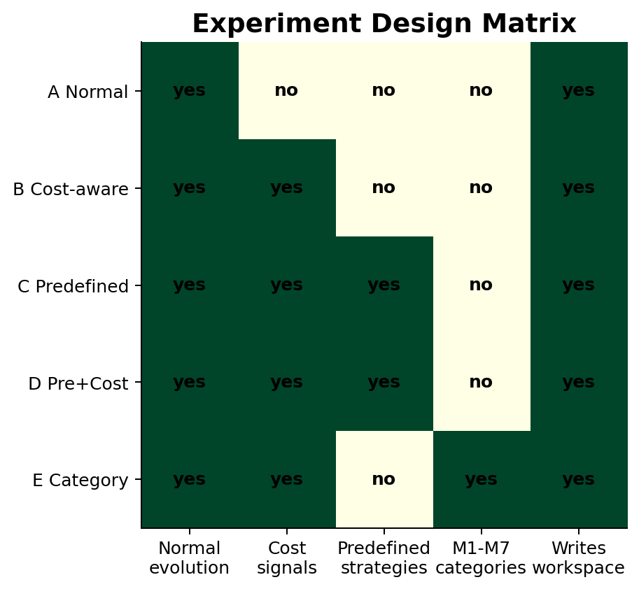

| 组别 | run label | 模式 | 核心差异 |
|---|---|---|---|
| A | `A_normal_self_evolve` | `normal-evolve` | 普通自进化，不提供显式成本反馈，不启用预定义效率策略 |
| B | `B_cost_aware_emergence` | `cost-aware` | 普通自进化 + 中性成本反馈 proposer，不暴露预定义策略 |
| C | `C_predefined_control` | `predefined-control` | 普通自进化 + 显式启用预定义效率策略 |
| D | `D_predefined_cost_aware_latest` | `predefined-cost-aware` | 预定义效率策略 + 成本反馈 proposer |
| E | `E_category_seeded_latest` | `category-seeded-cost-aware` | 成本反馈 + M1-M7 弱类别先验，不给具体策略名 |

## 3. 实验输入

### 3.1 任务输入

每个 SWE-bench task 的输入包含：

| 字段 | 说明 |
|---|---|
| `instance_id` | 任务 ID，例如 `django__django-11790` |
| `problem_statement` | issue 描述，是 agent 的主要自然语言输入 |
| `repo` | 目标仓库 |
| `base_commit` | 初始代码版本 |
| `docker_image` | 可复现实验环境 |
| `test_patch` | 官方用于评测的测试补丁 |
| `FAIL_TO_PASS` | 修复后应通过的测试 |
| `PASS_TO_PASS` | 不应回归的测试 |
| `patch` | 数据集中的参考 patch，仅作为 metadata 保存，不给 agent 当答案 |

### 3.2 Agent 输入

agent 实际接收的不只是 issue 文本，还包括：

1. workspace 中的基础系统 prompt。
2. workspace 中已有或演化产生的 skills。
3. workspace 中的 prompt fragments。
4. workspace memory。
5. tools registry 中定义的工具。
6. 可选 efficiency config。
7. Docker testbed 中的真实代码库。

### 3.3 Proposer 输入

cost-aware proposer 不读取完整 conversation，而读取 runner 构造的中性成本反馈：

```json
{
  "batch": 1,
  "summary": {
    "tasks": 2,
    "success": 1,
    "success_rate": 0.5,
    "avg_tokens": 668161,
    "avg_cost": 0.49,
    "cost_of_pass": 0.97,
    "avg_tool_calls": 55
  },
  "task_cost_and_behavior_signals": [
    {
      "task_id": "django__django-11790",
      "success": true,
      "tool_calls": 45,
      "turns": 37,
      "repeated_actions": [],
      "behavior_stats": {
        "repeated_exact_inputs": 0,
        "repeated_test_inputs": 0,
        "same_state_repeated_tests": 0
      }
    }
  ]
}
```

E 组额外加入 M1-M7 taxonomy：

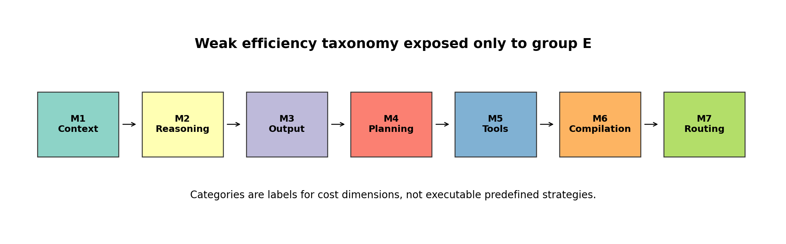

这些类别只描述成本维度，不包含任何已实现策略名称或 prompt block。

## 4. 实验流程

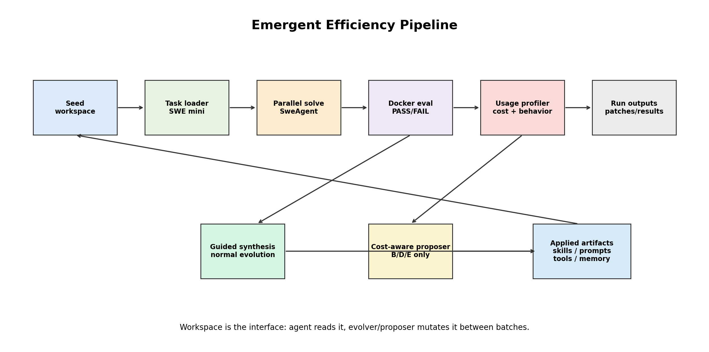

每组实验都执行同一套 batch loop。

### 4.1 Step 1：创建实验 workspace

runner 创建输出目录，并复制 `seed_workspaces/swe` 到：

```text
logs/emergent_efficiency/<run>/workspace/
```

隐藏组 A/B/E 会删除或清理具体效率策略 artifact，并执行策略名 redaction。C/D 会写入预定义 active strategies。

### 4.2 Step 2：加载任务并分 batch

`SweVerifiedMiniBenchmark.get_tasks(split="test", limit=10)` 从数据集中加载 10 个任务，按 `batch_size=2` 切成 5 批。每批并行解两个任务。

### 4.3 Step 3：并行求解

每个任务进入独立 worker：

```text
Task dict
  -> SweAgent(workspace, model, max_steps, window_size, runtime_config)
  -> agent.solve(task)
  -> benchmark.evaluate(task, trajectory)
  -> result dict
```

求解过程中 agent 可以使用 workspace 工具，例如 shell、文本编辑、提交 patch、运行 Python helper。每个工具调用被记录到 trajectory。

### 4.4 Step 4：Docker 评测

评测阶段在 SWE-bench Docker 容器中执行：

1. 启动任务对应 Docker image。
2. 在 `/testbed` 应用 agent patch。
3. 应用 test patch 或执行官方 eval script。
4. 运行 FAIL_TO_PASS/PASS_TO_PASS 测试。
5. 返回 `success` 和 `score`。

这保证 success 不是 agent 自报，而是环境中真实测试结果。

### 4.5 Step 5：写出任务结果

每个 batch 后 runner 写出：

| 文件 | 内容 |
|---|---|
| `results.json` | 到目前为止所有任务的完整结果 |
| `summary.json` | by-batch + overall 汇总 |
| `summary.csv` | 便于画图和横向比较 |
| `behavior_stats.json` | 重复行为统计 |
| `patches/*.diff` | 每个任务 patch |
| `conversations/*.json` | 每个任务完整 conversation |
| `system_prompts/*.md` | 每个任务实际 system prompt |
| `workspace/evolution/*` | 写入 workspace 的轨迹和 observation |

### 4.6 Step 6：普通 self-evolution

除最后一个 batch 外，每批任务完成后都会运行普通自进化：

```text
batch observations
  -> GuidedSynthesisEngine
  -> parse solver skill proposals
  -> LLM curator ACCEPT/MERGE/SKIP
  -> write selected skills/fragments/memory
```

这一步用于让所有组都有相同的“经验积累”能力。

### 4.7 Step 7：cost-aware proposer

B/D/E 组额外运行 proposer：

```text
batch results
  -> summarize cost and behavior waste
  -> proposer LLM returns JSON proposals
  -> validate kind/confidence/content
  -> apply top proposals
  -> snapshot workspace
```

proposal 被写入 workspace 后，下一批任务会自然读取。这个机制允许策略跨 batch 复用。

## 5. 指标定义

| 指标 | 定义 | 解读 |
|---|---|---|
| `success_rate` | 成功任务数 / 总任务数 | 正确性主指标 |
| `avg_tokens` | 平均 input + output token，不含 cache | 上下文和输出成本 |
| `avg_cost` | 平均总成本，包含 input/output/cache/route cost | 价格口径指标 |
| `cost_of_pass` | 总成本 / 成功任务数 | 最重要的效率指标之一，惩罚失败 |
| `avg_tool_calls` | 平均工具调用数 | 行为效率指标 |
| `turns` | agent 轮数 | 推理/交互长度 |
| `repeated_exact_inputs` | 完全重复工具输入次数 | 低效探索信号 |
| `repeated_test_inputs` | 重复测试命令次数 | 测试循环冗余信号 |
| `same_state_repeated_tests` | 未改代码状态下重复同一测试 | 更强的冗余测试信号 |
| `prompt_fragment_visible_tasks` | 任务 prompt 中可见 emergent fragment 的任务数 | emergent artifact 是否进入 agent prompt |
| `emergent_skill_calls` | 后续任务实际读取 emergent skill 的次数 | 策略是否被复用 |

## 6. 总体结果

| 组别 | 成功数 | 成功率 | avg tokens | avg cost | cost of pass | tool calls | avg tool calls |
|---|---:|---:|---:|---:|---:|---:|---:|
| A Normal self-evolve | 8/10 | 80% | 520,335 | $0.44 | $0.55 | 458 | 45.8 |
| B Cost-aware emergence | 8/10 | 80% | 459,870 | $0.43 | $0.54 | 398 | 39.8 |
| C Predefined control | 9/10 | 90% | 277,309 | $0.34 | $0.38 | 297 | 29.7 |
| D Predefined + cost-aware | 9/10 | 90% | 429,633 | $0.47 | $0.52 | 349 | 34.9 |
| E Category seeded | 10/10 | 100% | 474,080 | $0.46 | $0.46 | 395 | 39.5 |

核心观察：

1. C 组是成本最优控制组，`cost_of_pass=$0.38`，说明手工预定义效率策略仍然非常强。
2. E 组是正确性最稳的自然涌现变体，成功率 100%，`cost_of_pass=$0.46`，比 A 组低约 16.4%。
3. B 组相比 A 降低 token 和工具调用，但成功率没有提升，说明单纯成本反馈能减负，但不一定改善正确性。
4. D 组在已有预定义策略上继续加 proposer，成功率保持 90%，但成本高于 C，说明增量 proposer 可能引入额外 prompt/行为负担。
5. A 组第一批 0/2 失败，对 overall success 和 `cost_of_pass` 影响很大，说明普通 self-evolution 初始阶段不稳定。

## 7. 成功率与成本前沿

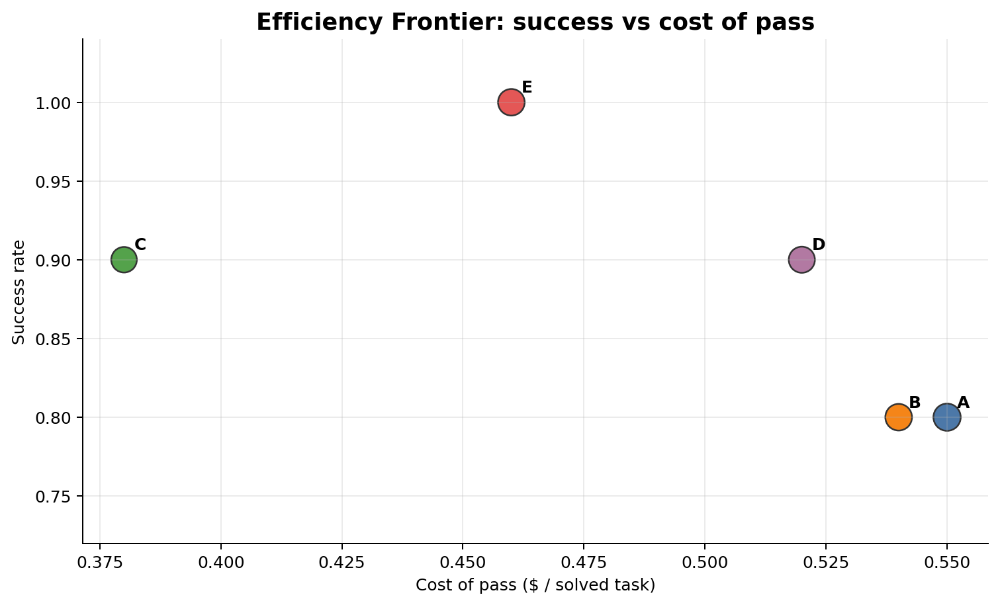

图中越靠左上越好。C 组靠左且成功率 90%，是工程成本控制最强的组；E 组位于更高成功率但稍高成本的位置，体现“弱类别先验 + 自然涌现”在正确性上的优势。A/B 成功率相同，但 B 更省 token 和 tool calls，说明成本反馈确实改变了行为。

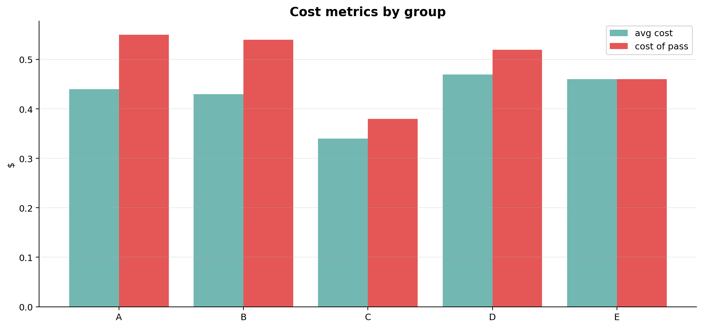

`cost_of_pass` 比 `avg_cost` 更严格，因为失败任务也消耗成本但不贡献成功数。A/B 的 avg cost 接近，但 `cost_of_pass` 偏高，说明失败会显著拉低单位成功效率。

## 8. Token、成本与工具调用

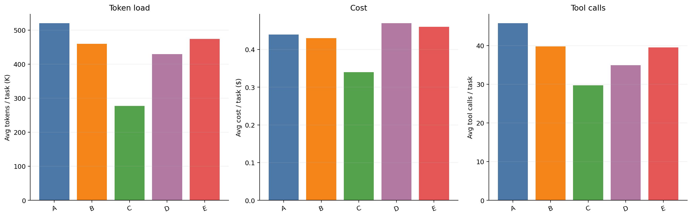

从 token 和工具调用看：

| 对比 | 变化 |
|---|---|
| B vs A | avg tokens 下降 11.6%，avg cost 下降 2.3%，cost_of_pass 下降 1.8% |
| C vs A | avg tokens 下降 46.7%，avg cost 下降 22.7%，cost_of_pass 下降 30.9% |
| D vs A | avg tokens 下降 17.4%，avg cost 上升 6.8%，cost_of_pass 下降 5.5% |
| E vs A | avg tokens 下降 8.9%，avg cost 上升 4.5%，cost_of_pass 下降 16.4% |

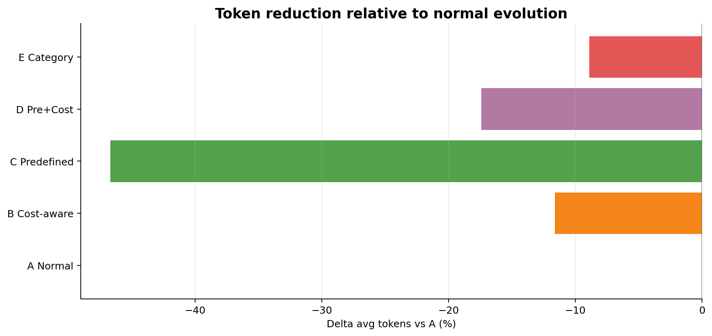

C 组大幅降低 token，主要来自预定义策略的 observation masking、adaptive tool trimming、skill compilation 等手工机制。E 组 token 降幅没有 C 大，但成功率更高，说明它的收益更偏“提高解题路径稳定性”而不只是压缩上下文。

## 9. Batch 趋势

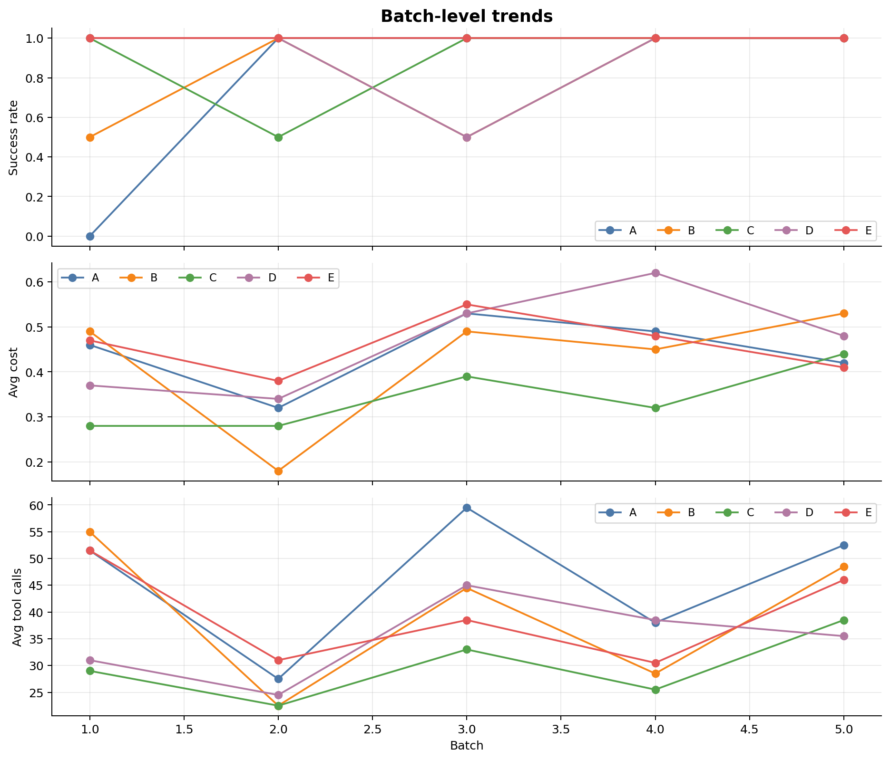

batch 级趋势显示：

1. A 组 Batch 1 失败率最高，随后 4 个 batch 全部成功，符合 self-evolution 前期不稳定、后期改善的模式。
2. B 组 Batch 1 和 Batch 3 各有失败，但 Batch 2/4/5 成功，说明成本反馈生成的策略需要时间积累，不一定立即稳定。
3. C 组整体工具调用最低，证明预定义效率策略对工具层和上下文层有强约束。
4. D 组 Batch 3 出现 0.5 成功率且 avg cost 较高，说明“预定义策略 + proposer”并非单调叠加。
5. E 组 5 个 batch 全部成功，且工具调用稳定在中等水平，是本轮中最稳定的自然涌现组。

## 10. 单任务成功矩阵

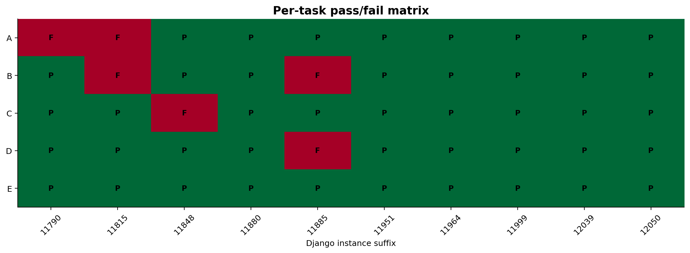

任务级别观察：

| 任务 | 失败组 |
|---|---|
| `django__django-11790` | A |
| `django__django-11815` | A、B |
| `django__django-11848` | C |
| `django__django-11885` | B、D |
| 其他 6 个任务 | 五组全部成功 |

E 组在 10 个任务上全部通过，这对“弱类别先验是否有帮助”是最直接的正向信号。C 组虽然成本最低，但在 `django__django-11848` 上失败，说明手工策略有时可能过度压缩或改变求解路径。

## 11. 行为信号

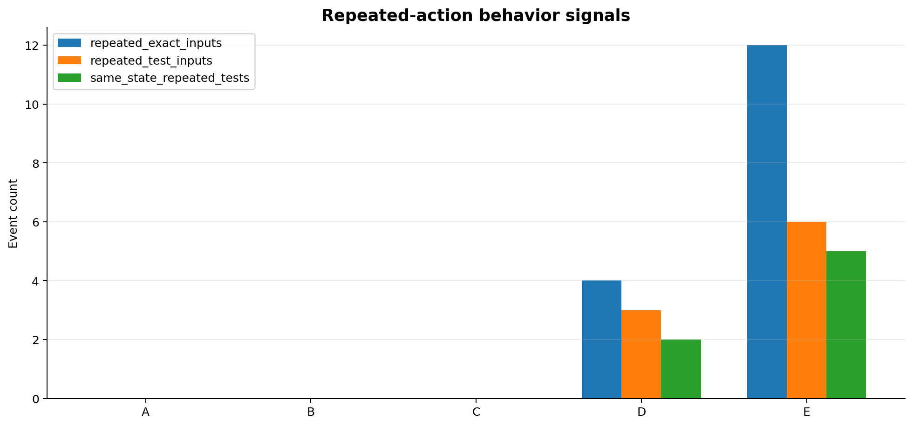

重复行为指标需要谨慎解释。A/B/C 在该汇总口径下重复信号为 0，而 D/E 有可见 prompt fragment 后出现少量重复测试信号。这里不能简单说“重复越多越差”，因为有些重复发生在后续验证阶段，可能提高成功率。

更合理的解释是：

1. `same_state_repeated_tests` 是最明确的浪费信号，E 组仍有 5 次，说明 emergent 策略还没有完全消除重复测试。
2. E 组虽然重复信号较高，但 100% 成功，说明它可能把一部分成本花在谨慎验证上。
3. D 组 prompt fragment 可见任务数为 8，且 violation events 为 1，说明新 prompt 进入了 agent，但执行一致性仍有限。

## 12. Proposal 与采纳分析

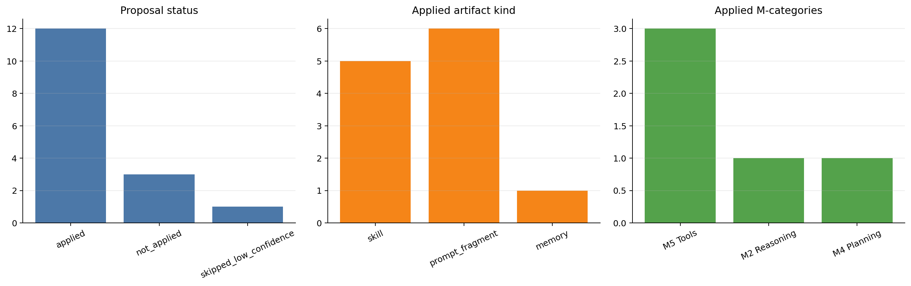

三组会产生 cost-aware proposal：

| 组别 | proposal reports | proposal count | adopted count | 主要 artifact |
|---|---:|---:|---:|---|
| B | 4 | 7 | 6 | skill、prompt fragment |
| D | 4 | 4 | 3 | prompt fragment |
| E | 4 | 5 | 3 | memory、prompt fragment、skill |

B 组的典型 proposal：

| 名称 | kind | 核心作用 |
|---|---|---|
| `rerun_identical_probe_only_after_change` | skill | 不在状态未变时重复执行相同 probe |
| `narrow_test_reruns_after_fix` | skill | 编辑后优先 rerun 最小测试目标 |
| `scoped_reads_with_grep` | skill | 先 grep 定位，再读取小范围上下文 |
| `first_edit_checkpoint` | prompt_fragment | 避免无限探索，形成最小 patch |
| `deduplicate_repeated_test_runs` | skill | 去重重复测试 |
| `consolidate_environment_setup_and_exploratory_snippets` | prompt_fragment | 合并重复环境 setup 和 Python snippets |

D 组的典型 proposal：

| 名称 | kind | 核心作用 |
|---|---|---|
| `django_probe_batching` | prompt_fragment | 合并多个 Django introspection probe |
| `targeted_test_validation_loop` | prompt_fragment | 编辑前后必须有 focused test validation |
| `cap_remote_history_prospecting` | prompt_fragment | 限制远程 GitHub 历史考古，回到本地代码和测试 |

E 组的典型 proposal：

| 名称 | kind | 类别 | 核心作用 |
|---|---|---|---|
| `suppress_same_state_test_reruns` | memory | M5 Tools | 工作区状态未变时不重复同一测试 |
| `read_target_source_before_search` | prompt_fragment | M5 Tools; M2 Reasoning | 先读失败测试指向的源文件，再做广度搜索 |
| `test_targeting_probe` | skill | M5 Tools; M4 Planning | 编辑前先跑最小相关模块测试，避免宽泛重复测试 |

最重要的复用证据是：E 组 `test_targeting_probe` 在后续任务中出现 1 次 `emergent_skill` 命中，说明它不是只被写入文件，而是被后续 agent 实际读取。

## 13. 输出结果如何从输入生成

下面按数据流串起完整过程：

```text
SWE task row
  -> Task(id, problem_statement, metadata)
  -> worker process
  -> SweAgent loads workspace
  -> Strands tool loop in Docker testbed
  -> patch diff
  -> SWE-bench evaluation
  -> result dict with success/cost/tokens/tools/steps
  -> summary.csv + results.json + behavior_stats.json
  -> Observation(task, trajectory, feedback)
  -> GuidedSynthesisEngine normal evolution
  -> optional cost-aware feedback JSON
  -> proposer JSON proposals
  -> proposal adoption into workspace artifact
  -> next batch reads updated workspace
  -> final run-level report and figures
```

最终每组输出目录可以按以下顺序检查：

1. 看 `summary.csv`：确认总体 success/cost/token。
2. 看 `results.json`：定位单个任务的 patch、steps、usage。
3. 看 `patches/*.diff`：检查修复内容。
4. 看 `emergence/proposals.jsonl`：检查 proposer 到底看到了什么反馈，输出了什么。
5. 看 `emergence/proposal_adoption.json`：检查哪些 proposal 真正写入 workspace。
6. 看 `workspace/`：确认策略是否持久化。
7. 看 `system_prompts/*.md`：确认后续任务是否实际看到 prompt fragment/skill。
8. 看 `behavior_stats.json`：确认行为层是否变化。

## 14. 结论

本轮实验支持三个判断：

1. 预定义策略仍是成本控制上限。C 组以 90% 成功率获得最低 `avg_cost=$0.34` 和最低 `cost_of_pass=$0.38`。
2. 成本反馈能改变 agent 行为。B 组相对 A 降低 11.6% avg tokens 和 13.1% tool calls，但正确性未改善。
3. 弱类别先验最有研究价值。E 组不暴露具体策略名，却达到 10/10 成功，并产出可落地、可复用的 M5/M4/M2 类 proposal；其 `cost_of_pass=$0.46` 明显优于 A/B/D，仅落后于强手工策略 C。

更审慎地说，E 组不是证明 agent 已经“自主发现完整 EvoEfficient”，而是证明：在只给成本维度 taxonomy 和中性行为信号时，agent 可以产生局部有效、能写入 workspace、且至少一次被后续任务复用的效率策略。这正是自然涌现实验最关键的机制证据。

## 15. 后续建议

1. 扩大任务数到 50 或 100，并固定随机种子/任务顺序，降低单个 batch 偶然性的影响。
2. 做 held-out reuse：先在 train batches 中产生 emergent artifact，再冻结 workspace 到 held-out tasks 测试。
3. 增加盲 post-hoc 分类器：不看组别和结果，只根据 proposal/轨迹判断策略类别与新颖性。
4. 对 prompt fragment 执行一致性做更强检测，例如比较 fragment trigger 与实际 steps 是否匹配。
5. 增加 ablation：只保留 E 组某个 proposal，看单个 emergent artifact 是否独立贡献收益。
6. 记录 wall-clock、Docker 测试耗时和 LLM route cost 的更细粒度分解，区分 token 省钱与工具省时。

