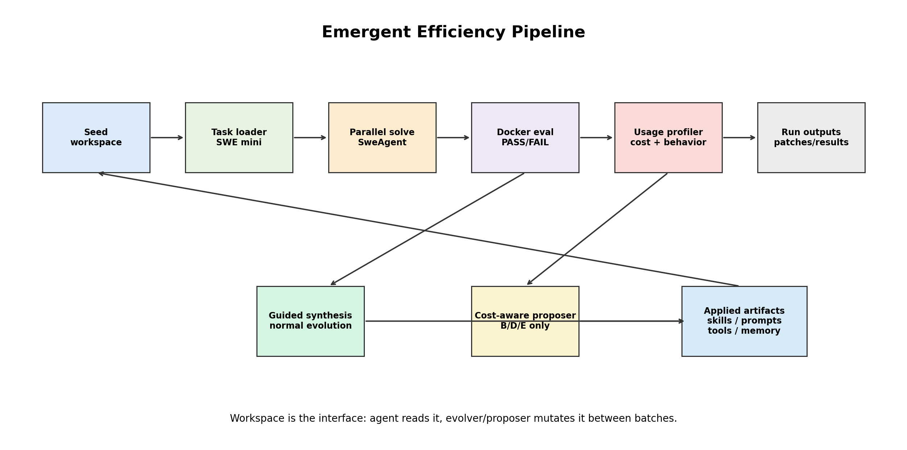
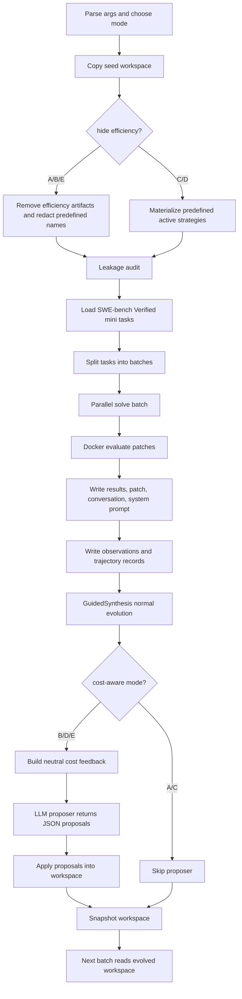
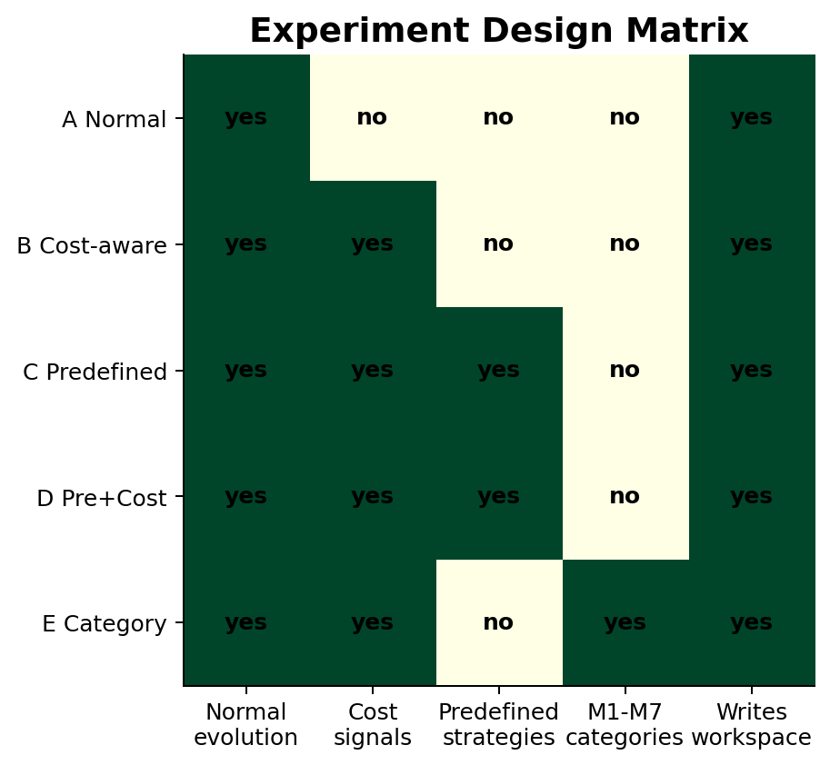
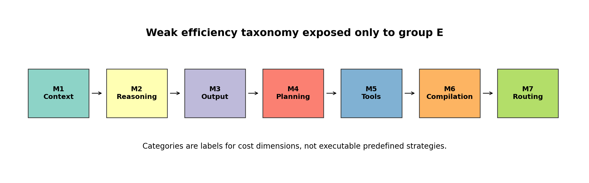

# A-Evolve 自然涌现效率策略实验：方法、Pipeline 与创新点

本文档总结 A-Evolve 项目中面向 SWE-bench 的自然涌现效率策略实验，重点覆盖 `examples/swe_examples_new/emergent_efficiency`。实验目标不是直接验证一组人工写好的效率策略是否有效，而是研究：当 agent 只看到任务轨迹、成本、token、工具调用和成功/失败信号时，是否能通过自进化生成可复用的省成本行为。



## 1. 项目总体方法

A-Evolve 的核心设计原则是：workspace 就是接口。agent 不直接和 evolver 通信；agent 每次解题从 workspace 读取 prompt、skills、tools、memory、efficiency 配置，evolver 或 cost-aware proposer 则在 batch 之间改写同一个 workspace。这样可以把“任务求解”“评测”“进化算法”“效率策略”拆成彼此独立的模块。

整体循环如下：

1. Benchmark 加载任务，形成 `Task(id, input, metadata)`。
2. `SweAgent` 从 workspace 读取系统提示词、技能、工具注册表、memory 和可选效率配置。
3. agent 在 Docker SWE-bench 环境中定位 bug、修改代码、运行测试、提交 patch。
4. benchmark 对 patch 做真实评测，输出 `Feedback(success, score, detail)`。
5. runner 收集 `Trajectory`、工具调用、token/cost、patch、conversation、system prompt。
6. 普通自进化路径使用 `GuidedSynthesisEngine` 归纳 solver 自己提出的技能。
7. 自然涌现效率路径额外把中性成本摘要交给 proposer，由 proposer 生成 skill、prompt fragment、tool 或 memory。
8. 新 artifact 写回 workspace，下一批任务会自动读到这些改动。

这种设计使实验可以清晰地区分三类变化来源：

| 变化来源 | 写入位置 | 代表内容 | 对后续 batch 的影响 |
|---|---|---|---|
| 普通 solver 自进化 | `skills/`、`memory/`、`prompts/` | 通用 debug/verification 技能 | 提高 SWE 修复稳定性 |
| 预定义效率策略 | `efficiency/active_strategies.yaml`、策略 prompt block、materialized skill | observation masking、tool trimming 等 | 手工注入成本控制 |
| 自然涌现效率策略 | `prompts/fragments/`、`skills/`、`tools/`、`memory/` | 从成本反馈中生成的复用规则 | 让 agent 自己形成省成本行为 |

## 2. 方法设计动机

自然涌现效率实验要解决的问题比普通 “agent 解 SWE-bench” 更复杂。它不仅要判断 patch 是否正确，还要判断效率策略从哪里来、是否泄漏、是否被持久化、是否真的改变后续行为。因此方法设计围绕四个原则展开。

### 2.1 为什么用 workspace 作为唯一接口

直接让 solver、evolver、profiler、proposer 在内存里相互调用，会让实验很难解释：一个模块到底看到了哪些信息、哪些策略是在什么时候注入的、下一批任务为什么会改变行为，都不容易复盘。A-Evolve 改用文件系统 workspace 作为唯一共享接口，原因有五点：

| 设计需求 | 如果直接内存通信的问题 | workspace 设计的收益 |
|---|---|---|
| 可审计 | LLM prompt 和中间状态可能只存在进程内 | 每次 batch 后都有文件快照，可回放、可 diff |
| 可隔离 | 不同实验组容易共享隐藏状态 | 每个 run 复制独立 workspace，避免状态串扰 |
| 可复用 | 进化出的能力难迁移到其他 runner | skills/prompts/tools/memory 都是可复制 artifact |
| 可解释 | 难判断策略是否真的进入后续 agent | 后续 system prompt、skill 读取、tool registry 可检查 |
| 可扩展 | 新算法需要改 solver 内部接口 | 新 evolver 只要会读写 workspace 即可接入 |

这种设计让实验问题从“某个黑盒 agent 表现变好了吗”变成“哪些文件被写入、何时被读取、对应行为是否改变”。它牺牲了一点运行时直接性，但换来更强的实验可追踪性。

### 2.2 为什么按 batch 进化，而不是每个任务后立即进化

实验采用 batch loop：每批先并行解多个任务，再统一做 normal evolution 和 cost-aware proposal。这样设计主要有三点原因：

1. 单个任务的失败或高成本可能是偶然现象，batch 汇总更容易识别跨任务模式。
2. SWE-bench 解题耗时长，batch 内并行能提升吞吐，而 batch 间进化能保留“下一代 agent”的概念。
3. 进化干预只影响后续 batch，不回头改变已完成任务，因此因果方向清楚。

如果每个任务后立即进化，后一个任务可能看到前一个任务产生的 artifact，虽然更自适应，但结果强依赖任务顺序；如果所有任务结束后才进化，又无法观察策略是否在同一实验中被复用。batch 设计是在复用证据和实验稳定性之间的折中。

### 2.3 为什么保留普通 Guided Synthesis 作为所有组共享步骤

自然涌现实验的核心比较不是“有无自进化”，而是“成本反馈是否带来额外效率策略”。因此 A/B/C/D/E 五组都保留普通 `GuidedSynthesisEngine`。这样 B/E 相对 A 的差异才主要来自成本反馈或类别 taxonomy，而不是普通 solver-proposed skill 机制。

这也是为什么文档里把自进化拆成两条路径：

| 路径 | 所有组都有吗 | 输入 | 产物 | 研究作用 |
|---|---|---|---|---|
| Normal evolution | 是 | solver 自己在任务后提出的 skill proposal | 普通 skills/fragments/memory | 控制普通经验积累 |
| Cost-aware emergence | 仅 B/D/E | 成本、token、工具调用、浪费信号 | 效率相关 skills/fragments/tools/memory | 测试成本压力是否诱导新策略 |

### 2.4 为什么不用“直接告诉 agent 省 token”

简单提示 agent “少用 token、少调用工具” 可能带来错误的省成本方式：少读代码、少跑测试、提前提交，甚至空 patch。该实验采用 success-first 约束：proposer 必须写 trigger、do-not-trigger、expected_savings 和 correctness_risk，明确哪些情况下不能应用策略。评价也使用 `cost_of_pass`，失败任务仍然计入成本，避免通过降低成功率换取表面成本下降。

### 2.5 为什么引入 A/B/C/D/E 五组，而不是只做 baseline vs cost-aware

单纯比较 A 和 B 只能回答“成本反馈有没有效果”，不能解释效果来自哪里。五组设计将先验强度拆开：

| 组别 | 先验强度 | 回答的问题 |
|---|---|---|
| A | 无效率先验 | 普通自进化本身能做到什么 |
| B | 只有中性成本反馈 | 成本压力能否自然诱导策略 |
| C | 强手工策略 | 人工策略能达到什么工程上限 |
| D | 强手工策略 + 成本反馈 | 已有策略上是否还有增量自进化空间 |
| E | 弱类别先验 + 成本反馈 | 只知道成本维度是否足以诱导可执行策略 |

E 组是最关键的中间条件。它不像 B 那样完全无结构，也不像 C/D 那样暴露具体策略名和实现，而是只给 M1-M7 抽象成本维度。因此如果 E 组产生有效策略，可以说明“给出成本维度框架”本身有助于策略归纳。

## 3. 方法模块详解

下图展示了模块之间的数据流。上半部分是任务执行和评测，下半部分是进化和策略写回。


### 3.1 Runner / Experiment Controller

实现位置：`examples/swe_examples_new/emergent_efficiency/run_emergent_efficiency.py`

runner 是整个实验的控制平面，负责确保不同组之间除实验变量外尽量一致。它不解决 SWE 任务，也不生成 patch，而是调度 task、workspace、agent、benchmark、evolver、proposer 和 report。

| 项目 | 内容 |
|---|---|
| 输入 | CLI 参数、seed workspace、SWE-bench dataset、模型配置 |
| 输出 | run 目录、workspace 副本、results、summary、patches、emergence 记录、figures |
| 核心函数 | `main()`、`_solve_batch()`、`solve_one_task()`、`_write_run_outputs()` |
| 设计原因 | 把实验条件固定在一个入口中，减少多个 runner 间实现差异导致的偏差 |

runner 的关键职责：

1. 解析实验组模式。
2. 为每个 run 创建独立输出目录。
3. 复制 seed workspace。
4. 根据 mode 决定隐藏效率策略或 materialize 预定义策略。
5. 加载任务并切 batch。
6. 并行启动 worker 解题。
7. 写出 patch、conversation、system prompt 和 metrics。
8. 在 batch 间调用 normal evolution。
9. 在 B/D/E 中调用 cost-aware proposer。
10. 把 proposal 应用回 workspace 并记录 adoption。

设计上 runner 把每个 batch 的输出立即落盘，而不是等全实验结束后统一写。这样即使中途失败，也能保留已完成 batch 的轨迹、成本和 proposal，便于复盘。

### 3.2 Workspace Module

实现位置：`agent_evolve/contract/workspace.py`

workspace 模块提供 typed read/write API，封装对 prompt、skill、tool、memory、evolution 文件的访问。它的作用不是提高算法复杂度，而是让“agent 可进化部分”有稳定的文件系统 contract。

| API | 作用 | 为什么需要 |
|---|---|---|
| `read_prompt()` / `write_prompt()` | 读写基础 system prompt | 允许 evolver 改变 agent 行为底座 |
| `write_fragment()` / `list_fragments()` | 管理 prompt fragments | 适合写短规则，避免整体重写 system prompt |
| `write_skill()` / `list_skills()` | 管理 `SKILL.md` | 适合写触发式可复用 workflow |
| `read_tool_registry()` / `write_tool_registry()` | 管理工具清单 | 允许 proposer 增加确定性工具 |
| `add_memory()` / `read_all_memories()` | 管理 JSONL memory | 记录跨任务经验，不污染 prompt 主体 |
| `read_evolution_history()` | 读取进化元数据 | 支持后续更复杂的演化算法 |

为什么不把所有策略都写进同一个 prompt 文件？因为不同 artifact 的行为语义不同。prompt fragment 会默认可见，适合轻量规则；skill 需要按描述触发，适合较长流程；tool 是可执行能力，必须更严格验证；memory 是经验事实，适合积累但不应强制每次执行。

### 3.3 Benchmark / Task Loader Module

实现位置：`agent_evolve/benchmarks/swe_verified_mini/benchmark.py`

benchmark 模块承担两个职责：把数据集行转换成标准 `Task`，以及对 agent patch 进行真实评测。

| 阶段 | 输入 | 输出 | 作用 |
|---|---|---|---|
| `get_tasks()` | HuggingFace dataset row | `Task(id, input, metadata)` | 标准化任务输入 |
| `evaluate()` | `Task` + `Trajectory.output` patch | `Feedback(success, score, detail)` | 在 Docker 中验证 patch |

这样设计的原因是把 “任务加载/评分” 和 “agent 求解” 分离。agent 不需要知道 SWE-bench 内部如何生成 eval script；evolver 也不需要知道 Docker 如何评分。所有算法只面对统一的 `Task -> Trajectory -> Feedback -> Observation` 类型流。

真实 Docker 评测非常重要。若只让 LLM 判断 patch 是否正确，成本策略可能学到“写看起来合理的 patch”而不是“通过测试的 patch”。SWE-bench 环境中的 PASS/FAIL 是实验可信度的基础。

### 3.4 SweAgent Module

实现位置：`agent_evolve/agents/swe/agent.py`

`SweAgent` 是任务求解模块。它把 workspace 中的可进化能力加载成一次 Strands Agent 运行，并在 SWE-bench Docker testbed 中执行工具循环。

| 子模块 | 输入 | 输出 | 作用 |
|---|---|---|---|
| workspace loader | prompt、skills、memory、tools registry | system prompt 和 tool list | 构造本轮 agent 能力 |
| tool loader | `tools/registry.yaml` | Python callable tools | 支持新增工具热加载 |
| efficiency config loader | `efficiency/active_strategies.yaml` 或 runtime config | 策略 prompt/参数 | 只在 C/D 或显式策略模式生效 |
| solve loop | `Task.input` + tools + prompt | `Trajectory` | 产生 patch 和完整 steps |
| usage aggregation | model messages metadata | token/cost summary | 为 cost-aware feedback 提供数据 |

为什么让 agent 每个任务重新从 workspace 加载？因为 batch 间 workspace 会变化。若 agent 常驻内存，可能读不到新策略，或者残留旧策略。重新加载虽然有开销，但保证每个任务的能力来源可追溯。

为什么使用工具 registry？因为自然涌现 proposal 允许生成 `tool` 类型 artifact。只要 proposer 写入 `tools/<name>.py` 并更新 registry，后续 agent 就能加载它。这给实验提供了从“文本策略”进化到“可执行能力”的通道。

### 3.5 Tool Execution Module

SWE workspace 的工具主要在 `seed_workspaces/swe/tools/`，包括 shell、文本编辑、Python 执行、提交 patch 等。工具是 agent 与 Docker testbed 的唯一实际交互方式。

| 工具层能力 | 作用 |
|---|---|
| 文件读取/搜索 | 定位 bug、理解代码 |
| shell / test | 运行复现脚本和测试 |
| text editor | 修改源代码 |
| submit | 输出最终 patch |
| dynamic tools | proposer 后续可加入的确定性 helper |

工具调用被记录为 `steps`，因此工具层也是行为分析的基础。实验中的重复命令、重复测试、未编辑前大量探索、接近 step limit 等信号，都是从 steps 中抽取的。

### 3.6 Usage Profiler Module

实现位置：`agent_evolve/efficiency/profiler.py`

profiler 负责把不同模型/接口可能返回的 usage 格式统一成稳定字段，并计算成本。

| 字段 | 含义 |
|---|---|
| `input_tokens` | 输入 token |
| `output_tokens` | 输出 token |
| `cache_read_input_tokens` | cache read token |
| `cache_write_input_tokens` | cache write token |
| `total_tokens` | input + output |
| `cost_units` | 按价格 profile 计算的总成本 |
| `main_model_cost_units` | 主模型成本 |
| `route_model_cost_units` | route model 成本 |
| `usage_record_quality` | token 记录质量 |

为什么需要 normalize？因为不同 provider 对 usage 字段命名不同，有的有 cache，有的没有，有的价格来自环境变量，有的来自 `cost_profile.yaml`。如果不统一字段，跨组比较很容易把记录格式差异误当成方法差异。

### 3.7 Behavior Signal Analyzer

实现位置：`run_emergent_efficiency.py` 中的 `_waste_signals()`、`_behavior_hit_stats()`、`_is_test_step()`、`_is_edit_step()`

行为分析模块把原始 steps 转成 proposer 可理解的浪费信号。

| 信号 | 计算方式 | 代表问题 |
|---|---|---|
| `repeated_exact_inputs` | 同一工具 action + input summary 重复 | 无效重复执行 |
| `repeated_test_inputs` | 同一测试命令重复 | 测试循环可能冗余 |
| `same_state_repeated_tests` | 同一 edit version 下重复测试 | 未改代码就重复验证 |
| `post_edit_repeated_tests` | 编辑后重复测试 | 可能是合理回归确认，也可能冗余 |
| `near_step_limit` | 工具调用接近 `max_steps` | 探索过长 |
| `no_edit_before_end` | 结束前从未编辑 | 可能陷入定位或历史考古 |
| `action_counts` | 工具 action 计数 | 识别 search/read/test/edit 比例 |

为什么给 proposer 行为信号，而不是完整轨迹？完整轨迹很长，既增加成本，也可能泄漏策略名称或任务细节。中性摘要保留了“哪里浪费”的结构信息，同时降低上下文成本和泄漏风险。

### 3.8 Normal Evolution / Guided Synthesis Module

实现位置：`agent_evolve/algorithms/guided_synth/engine.py`

普通自进化模块处理 solver 自己提出的技能。它不是本实验的效率创新点，但它是所有组共享的基础进化机制。

流程：

```text
Observation(task, trajectory, feedback)
  -> extract trajectory._skill_proposal
  -> parse NAME / DESCRIPTION / CONTENT / CONFIDENCE
  -> build curation context with existing skills
  -> curator outputs ACCEPT / MERGE / SKIP
  -> write accepted or merged skill to workspace
```

为什么由 solver 提 proposal，而不是 evolver 从头生成？solver 刚刚完成任务，知道自己在哪些步骤卡住、哪些方法有效；evolver 更适合做 curator，判断 proposal 是否泛化、是否重复、是否应合并。这样减少凭空生成技能的风险。

为什么偏好 MERGE？技能库太大时，agent 的 skill description 会增加 prompt 成本，也会让选择变难。少量宽泛技能比大量窄技能更适合跨任务复用。

### 3.9 Cost-aware Proposer Module

实现位置：`run_emergent_efficiency.py` 中的 `propose_emergent_efficiency()` 和 `_build_cost_feedback()`

cost-aware proposer 是自然涌现实验的核心。它读取 batch 级中性成本反馈，输出 JSON proposal。不同模式使用不同 system prompt：

| 模式 | System prompt | 特点 |
|---|---|---|
| B `cost-aware` | `EMERGENCE_SYSTEM_PROMPT` | 不允许使用预定义策略名，只从成本信号归纳 |
| D `predefined-cost-aware` | `PREDEFINED_COST_AWARE_SYSTEM_PROMPT` | 知道已有预定义策略，只提增量行为 |
| E `category-seeded-cost-aware` | `CATEGORY_SEEDED_SYSTEM_PROMPT` | 只给 M1-M7 类别标签，不给具体策略 |

proposer 输出结构中强制包含：

| 字段 | 设计原因 |
|---|---|
| `name` | 便于追踪策略身份，但由 LLM 自己命名 |
| `kind` | 决定写入 skill、prompt、tool 还是 memory |
| `description` | 作为短说明，支持后续 agent 判断是否需要使用 |
| `trigger` | 防止策略无条件触发 |
| `do_not_trigger` | 明确保护正确性的边界 |
| `content` | 真正写入 workspace 的规则/流程/工具源码 |
| `expected_savings` | 说明它预计降低哪个成本维度 |
| `correctness_risk` | 防止只追求低成本 |
| `confidence` | 低置信度可跳过 |
| `evidence` | 把 proposal 绑定到具体 task waste signal |
| `categories` | E 组必需，用于分析 M1-M7 归因 |

为什么要求 JSON only？因为 runner 需要自动解析和落地 proposal。自由文本虽然容易写，但难以可靠区分名称、类型、风险、证据和内容，也不利于后续统计。

### 3.10 Proposal Application Module

实现位置：`run_emergent_efficiency.py` 中的 `_apply_proposals()`

proposal 不是 LLM 说了就生效，必须经过应用层校验。

| 校验/处理 | 目的 |
|---|---|
| `max_apply` 截断 | 限制每个 batch 注入过多新规则 |
| 跳过 `LOW` confidence | 降低错误策略污染 workspace 的概率 |
| 空内容跳过 | 防止写入无效 artifact |
| kind normalize | 兼容 `prompt`、`fragment` 等别名 |
| tool validation | tool 必须有 `@tool` 和函数定义 |
| predefined name scan | 记录 proposal 是否包含预定义策略名 |
| adoption log | 记录每个 proposal 是否 applied/skipped |

为什么每个 proposal 都有 `proposal_id`？因为同名策略可能来自不同 batch。ID 形如 `emergent_gen02_01_test_targeting_probe`，包含 generation/batch 和序号，便于追踪它什么时候出现、写入哪里、后续是否被读到。

### 3.11 Predefined Strategy Module

实现位置：`agent_evolve/efficiency/strategies.py`

预定义策略只在 C/D 控制组显式启用，用于提供工程上限和对照。默认控制策略包括：

| 策略 | 模块 | 作用 |
|---|---|---|
| `observation_masking` | M1 context | 大型旧 observation 变成占位符，降低上下文负担 |
| `plan_template_cache` | M4 plan | 复用任务计划形状 |
| `adaptive_tool_trimming` | M5 tool | 对工具输出做任务感知裁剪 |
| `stagnation_rescue_stop` | stop guard | 接近步数上限时阻止无效探索 |
| `skill_compilation` | compilation | 写入紧凑 workflow skill |

为什么需要 C/D？如果没有预定义组，就无法判断自然涌现策略距离人工工程策略还有多远。C 是“手工策略单独作用”的对照；D 是“手工策略已存在时，成本反馈还能否提出增量策略”的对照。

### 3.12 Leakage Audit Module

实现位置：`run_emergent_efficiency.py` 中的 `_copy_seed_workspace()`、`_redact_predefined_names()`、`_strategy_leakage_scan()`

泄漏审计模块确保 B/E 的 proposal 不是复述预定义策略。

处理流程：

```text
copy seed workspace
  -> if hidden mode:
       remove efficiency directory
       preserve neutral cost_profile if present
       redact predefined strategy names in copied files
       remove active_strategies.yaml
  -> scan copied workspace
  -> write emergence/leakage_audit.json
  -> fail fast if any predefined names remain
```

为什么要连工具源码也 redact？因为 workspace tools 也是 agent 可见能力的一部分。如果某个工具注释或 marker 中包含策略名，proposer 或 agent 可能间接看到它。自然涌现实验必须把这类间接通道也封住。

### 3.13 Snapshot and Reporting Module

实现位置：`run_emergent_efficiency.py` 与 `agent_evolve/efficiency/visualization.py`

每个 batch 后，runner 会保存 workspace snapshot，并在 run 目录持续更新 summary 和 figures。

| 输出 | 作用 |
|---|---|
| `workspace_snapshots/after_batch_XX/` | 查看某个策略首次出现后的 workspace 状态 |
| `proposal_adoption.json` | proposal 生命周期记录 |
| `proposal_category_summary.json` | E 组类别分布统计 |
| `summary.csv` | 每 batch 和 overall 的指标表 |
| `figures/*.png` | 快速检查成本、成功率、工具调用趋势 |

为什么要保存 system prompt？prompt fragment 是否进入 agent，不能只看 workspace 文件存在；还要看某个任务实际拼接出的 system prompt 中是否包含对应 fragment。保存 `system_prompts/<instance>.md` 可以验证这一点。

### 3.14 Visualization Module

本文档中的图表由 `visual_docs/generate_visuals.py` 生成，直接读取已有实验结果，不重新跑实验。

| 图 | 数据来源 | 说明 |
|---|---|---|
| `pipeline_architecture.png` | 方法结构 | 展示模块关系 |
| `experiment_design_matrix.png` | 手写实验设计矩阵 | 展示 A/B/C/D/E 变量差异 |
| `m1_m7_taxonomy.png` | E 组 taxonomy | 展示弱类别先验 |
| `success_cost_frontier.png` | `overall_comparison.csv` | 成功率与 `cost_of_pass` |
| `tokens_cost_tools.png` | `overall_comparison.csv` | token、成本、工具调用 |
| `batch_trends.png` | 各 run `summary.csv` | batch 级趋势 |
| `task_success_matrix.png` | `task_matrix.csv` | 单任务 PASS/FAIL |
| `proposal_summary.png` | `proposal_catalog.csv` | proposal 状态、类型、类别 |

可视化模块单独放在 `visual_docs/` 下，是为了让报告生成与实验运行解耦。复现报告时只需已有 CSV/JSON，不需要重新调用 LLM 或 Docker。

## 4. Workspace Contract

SWE seed workspace 是实验的起点，默认路径为 `seed_workspaces/swe`。runner 在每次实验开始时把它复制到输出目录下的 `workspace/`，后续所有进化只修改这个副本，不修改原始 seed。

```text
seed_workspaces/swe/
  manifest.yaml
  prompts/
    system.md
    fragments/
  skills/
    */SKILL.md
  tools/
    registry.yaml
    bash.py
    text_editor.py
    submit.py
    python_exec.py
    sequentialthinking.py
  memory/
  efficiency/
    cost_profile.yaml
    routes.yaml
    rules.yaml
    strategy_library.yaml
    tools.yaml
```

关键 contract：

| 层 | 读取方 | 写入方 | 含义 |
|---|---|---|---|
| `prompts/system.md` | agent | seed 或 evolver | 基础行为约束 |
| `prompts/fragments/*.md` | agent | evolver/proposer | 可追加的行为片段 |
| `skills/*/SKILL.md` | agent | evolver/proposer | 带触发条件的可复用技能 |
| `tools/registry.yaml` | agent | seed 或 proposer | 工具清单 |
| `tools/*.py` | agent | seed 或 proposer | Strands `@tool` 实现 |
| `memory/*.jsonl` | agent | evolver/proposer | 跨任务记忆 |
| `efficiency/*.yaml` | agent | predefined 控制组 | 预定义效率策略配置 |
| `evolution/` | runner/evolver | runner | 每个 batch 的轨迹和 observation |

## 5. SWE Agent 求解方法

`SweAgent` 是面向 SWE-bench 的具体 agent。它在每个任务中完成如下工作：

1. 从任务 metadata 读取 Docker image、repo、base commit、test patch、FAIL_TO_PASS/PASS_TO_PASS。
2. 拉取或启动 SWE-bench 容器。
3. 从 workspace `tools/registry.yaml` 动态加载工具。
4. 拼接系统 prompt：base system prompt、验证规则、可选效率策略 prompt、skills、fragments。
5. 把 issue/problem statement、workspace memory、任务上下文交给 Strands Agent。
6. agent 通过工具读文件、搜索、编辑、跑测试、提交 patch。
7. runner 抽取最终 diff，benchmark 在 Docker 中应用 patch 并运行官方测试。
8. trajectory 末尾会附带 usage summary，包括 input/output/cache token、cost、per-turn usage、工具调用等。

输入不是简单的一段文本，而是 “问题陈述 + 仓库环境 + 可执行工具 + 进化后的 workspace”。输出也不是简单答案，而是 “patch + 轨迹 + 评测反馈 + 成本画像 + 可进化 proposal”。

## 6. 自然涌现效率 Runner Pipeline

`run_emergent_efficiency.py` 是独立 runner，不复用普通 `evolve_sequential.py` 的主循环。它的 pipeline 更适合做因果对照，因为不同实验组只在“是否暴露成本反馈/预定义策略/类别 taxonomy”上变化。



### 6.1 初始化阶段

runner 先解析 CLI 参数，然后确定最终输出目录。默认会追加时间戳，避免覆盖旧结果。

主要输入参数：

| 参数 | 默认值 | 作用 |
|---|---:|---|
| `--mode` | `cost-aware` | 实验组模式 |
| `--batch-size` | 2 | 每个 evolution batch 的任务数 |
| `--parallel` | 2 | batch 内并行 worker 数 |
| `--limit` | 6 | 任务总数，完整实验中设置为 10 |
| `--dataset` | `MariusHobbhahn/swe-bench-verified-mini` | SWE 任务数据集 |
| `--seed-workspace` | `seed_workspaces/swe` | 初始 workspace |
| `--model-id` | `us.anthropic.claude-opus-4-6-v1` | solver 模型 |
| `--max-steps` | 60 | 单任务最大工具步数 |
| `--window-size` | 40 | conversation window |
| `--max-proposals-per-batch` | 2 | 每个 batch 最多应用的 emergent proposal 数 |

### 6.2 防泄漏处理

自然涌现实验的关键是不能让 agent 看到预定义策略名称，否则后续生成相似策略不能算自然涌现。

在 `normal-evolve`、`cost-aware`、`category-seeded-cost-aware` 三种模式中，runner 会：

1. 复制 seed workspace 到 run 目录。
2. 删除 workspace 副本中的 `efficiency/` 目录，但保留中性 `cost_profile.yaml`。
3. 对 workspace 里的 `.md/.py/.yaml/.json/.txt` 扫描并替换预定义策略名。
4. 删除可能残留的 `efficiency/active_strategies.yaml`。
5. 执行 leakage audit；若仍发现预定义策略名，实验直接停止。

允许出现预定义策略名的只有 `predefined-control` 和 `predefined-cost-aware`，因为它们本来就是工程对照组。

### 6.3 Batch 解题阶段

每个 batch 通过 `ProcessPoolExecutor` 并行执行。每个 worker 输入一个 task dict：

```json
{
  "id": "django__django-11790",
  "input": "problem statement",
  "metadata": {
    "docker_image": "...",
    "repo": "...",
    "base_commit": "...",
    "FAIL_TO_PASS": [],
    "PASS_TO_PASS": []
  },
  "dataset": "MariusHobbhahn/swe-bench-verified-mini"
}
```

worker 返回的核心输出：

```json
{
  "instance_id": "django__django-11790",
  "success": true,
  "score": 1.0,
  "patch": "diff --git ...",
  "num_tool_calls": 40,
  "num_turns": 34,
  "total_tokens": 408371,
  "cumulative_input_tokens": 397000,
  "cumulative_output_tokens": 11371,
  "cost_units": 0.364464,
  "max_input_tokens_per_turn": 25000,
  "active_efficiency_strategies": [],
  "steps": ["tool/action trajectory"]
}
```

runner 立即把这些结果落盘：

| 文件 | 内容 |
|---|---|
| `results.json` | 每个 task 的完整结果和步骤 |
| `patches/<instance>.diff` | agent 提交的 patch |
| `conversations/<instance>.json` | Strands conversation |
| `system_prompts/<instance>.md` | 该任务实际使用的 system prompt |
| `emergence/observations/batch_XX.json` | batch observation 摘要 |
| `workspace/evolution/trajectories/*.json` | 写回 workspace 的完整轨迹 |

### 6.4 普通自进化阶段

所有实验组都会运行普通 self-evolution：`GuidedSynthesisEngine` 读取 batch observations，解析 solver 结束时提出的技能 proposal，由 curator 判断 `ACCEPT/MERGE/SKIP`，再写入 workspace。

这一步的意义是提供公平控制。也就是说，B/E 的收益不能简单归因于“有自进化”，因为 A 组也有同样的普通自进化；B/E 相比 A 多出来的变量是成本反馈或类别 taxonomy。

### 6.5 Cost-aware proposer 阶段

B/D/E 三组会在普通自进化之后额外调用 cost-aware proposer。runner 先把本 batch 的结果压缩成中性 JSON 反馈：

| 字段 | 含义 |
|---|---|
| `summary.tasks/success/success_rate` | batch 正确性 |
| `summary.avg_tokens` | 平均 token |
| `summary.avg_cost` | 平均成本 |
| `summary.cost_of_pass` | 每个成功任务成本 |
| `summary.avg_tool_calls` | 平均工具调用 |
| `task_cost_and_behavior_signals` | 每个任务的浪费信号 |
| `repeated_actions` | 重复命令/重复工具输入 |
| `same_state_repeated_tests` | 未改代码就重复运行同一测试 |
| `near_step_limit` | 是否接近步数上限 |
| `no_edit_before_end` | 是否一直探索但未编辑 |

proposer 输出必须是 JSON：

```json
{
  "proposals": [
    {
      "name": "test_targeting_probe",
      "kind": "skill",
      "categories": ["M5 Tools", "M4 Planning"],
      "description": "one sentence",
      "trigger": "when to use",
      "do_not_trigger": "when not to use",
      "content": "procedure or @tool source",
      "expected_savings": "why cost improves",
      "correctness_risk": "what can go wrong",
      "confidence": "HIGH",
      "evidence": ["task_id: observed waste -> proposed fix"]
    }
  ]
}
```

runner 对 proposal 做后处理：

| kind | 写入位置 | 应用规则 |
|---|---|---|
| `prompt_fragment` | `prompts/fragments/<proposal_id>.md` | 低成本行为规则，自动拼到后续 system prompt |
| `skill` | `skills/<proposal_id>/SKILL.md` | 带 trigger/do-not-trigger 的显式技能 |
| `tool` | `tools/<tool_name>.py` + `tools/registry.yaml` | 必须包含完整 Strands `@tool`，否则拒绝 |
| `memory` | `memory/strategy.jsonl` | 作为策略记忆供后续任务读取 |

低置信度 proposal 会被跳过；空内容、未知 kind、无效 tool 也会被跳过。

## 7. 五个实验组



| 组别 | 模式 | 目的 | 成本反馈 | 预定义策略 | 类别 taxonomy |
|---|---|---|---|---|---|
| A | `normal-evolve` | 普通自进化基线 | 否 | 否 | 否 |
| B | `cost-aware` | 主实验组，检验成本信号是否诱导效率策略 | 是 | 否 | 否 |
| C | `predefined-control` | 工程控制组，直接启用手写策略 | 是 | 是 | 否 |
| D | `predefined-cost-aware` | 预定义策略基础上再看成本反馈增量 | 是 | 是 | 否 |
| E | `category-seeded-cost-aware` | 只给弱类别先验，不给具体策略 | 是 | 否 | 是 |

E 组暴露的 M1-M7 只是成本维度标签，不是可执行策略。



| 类别 | 关注成本 | 可观察信号 | 允许 agent 自己发明的方向 |
|---|---|---|---|
| M1 Context | input tokens | prompt/context length、cache read/write | 上下文选择、压缩、证据保留 |
| M2 Reasoning | reasoning tokens 或代理指标 | turns、反思长度、重复分析 | 更短推理循环、假设收敛 |
| M3 Output | output tokens | 长 observation、长命令输出 | 简洁输出、结构化观察摘要 |
| M4 Planning | planning steps/tokens | plan 更新、step count | 阶段 gate、失败后重规划 |
| M5 Tools | tool calls | 重复命令、重复测试 | 工具选择、批量 probe、重复命令抑制 |
| M6 Compilation | LLM calls/steps | 重复 skill/prompt 装载 | playbook、skill/memory 汇编 |
| M7 Routing | cost per call | main/easy/hard cost | 便宜模型预筛、昂贵模型保留给关键决策 |

## 8. 输入与输出

### 8.1 输入

实验输入分为四层：

| 输入层 | 示例 | 被谁使用 |
|---|---|---|
| 数据集任务 | issue text、repo、base commit、test_patch、FAIL_TO_PASS | benchmark、agent |
| 执行环境 | SWE-bench Docker image、testbed、tools | agent、benchmark |
| 初始能力 | seed prompt、tools、skills、memory | agent |
| 实验控制 | mode、batch size、max steps、predefined strategies、category seed | runner |

### 8.2 中间产物

| 产物 | 意义 |
|---|---|
| `Trajectory.steps` | agent 的工具调用序列，是行为分析的基础 |
| `usage summary` | token、cache、cost、route cost、per-turn usage |
| `behavior_stats.json` | 重复命令、重复测试、prompt fragment violation |
| `normal_evolution.jsonl` | 普通 Guided Synthesis 的 batch 进化记录 |
| `proposals.jsonl` | cost-aware proposer 的输入反馈、原始输出、解析状态 |
| `proposal_adoption.json` | proposal 是否落地、落地到哪个 artifact |
| `workspace_snapshots/` | batch 后 workspace 状态，用于观察策略是否持久化 |

### 8.3 输出

最终输出包含三类：

| 输出类型 | 文件 | 用途 |
|---|---|---|
| 解题输出 | `patches/*.diff`、`results.json` | 评估 patch 是否通过 SWE-bench |
| 成本输出 | `summary.json`、`summary.csv`、`behavior_stats.json` | 计算成功率、成本、token、工具调用 |
| 进化输出 | `workspace/`、`emergence/*` | 分析 emergent proposal 是否被采纳、复用、命中 |

## 9. 创新点

### 9.1 从“选择预定义策略”转向“策略自然涌现”

传统效率实验通常预先写好策略，再看策略是否降低成本。本实验的 B/E 组刻意隐藏策略 registry，只给中性成本信号，让 agent/evolver 自己提出行为改变。这使研究问题从 “哪条手工规则有效” 转向 “成本压力是否能诱导出可复用策略”。

### 9.2 泄漏审计是实验设计的一部分

runner 不只是“不传策略名”，还会删除 workspace 中的效率目录、redact 工具源码里的策略名，并写出 `leakage_audit.json`。如果隐藏组仍有策略名泄漏，实验直接失败。这一点对“自然涌现”论证很关键。

### 9.3 成本反馈是中性行为摘要，不是策略标签

proposer 看到的是 token、cost、重复工具调用、重复测试、接近 step limit 等信号，而不是 `observation_masking` 或 `adaptive_tool_trimming` 这样的命名方案。它必须从现象归纳规则。

### 9.4 Proposal 可以落成多种 artifact

自然涌现策略不被限制为 prompt。它可以成为：

| artifact | 适合表达的策略 |
|---|---|
| prompt fragment | 短行为规则、触发/禁止条件 |
| skill | 可复用 workflow 或调试 playbook |
| tool | 确定性辅助工具 |
| memory | 跨任务策略经验 |

这比单纯改 prompt 更接近真实 agent 能力进化。

### 9.5 Success-first 成本优化

系统 prompt 明确要求 proposer 不允许通过提前停止、跳过调查、减少验证来假装省成本。评估也使用 `cost_of_pass`，强调每个成功任务成本，而不是只看平均 token。

### 9.6 弱类别先验组 E

E 组只提供 M1-M7 这类抽象成本维度，让 agent 在类别框架下自己生成可执行规则。这介于完全无先验的 B 组和强工程先验的 C/D 组之间，可以拆分“知道成本维度”和“直接获得手写策略”的差别。

### 9.7 同时观察性能、行为和持久化

实验不仅看 success/cost，还记录：

| 观察维度 | 问题 |
|---|---|
| 性能 | 是否通过任务？成本是否下降？ |
| 行为 | 是否减少重复命令、重复测试、无效探索？ |
| 产物 | proposal 是否被写入 workspace？ |
| 复用 | 后续任务是否真的读到/命中 emergent skill？ |
| 泄漏 | 是否出现预定义策略名？ |

因此该实验不是只做结果对比，而是在追踪 agent 行为如何被进化机制改变。

## 10. 方法局限

1. 任务数较小。当前 5 组对比以 10 个 SWE mini 任务为主，结论更适合描述机制和趋势，不能直接等同大规模 benchmark 结论。
2. batch 间存在 stochasticity。不同 rerun 的 A/B 成功率和成本可能变化，应明确引用具体 run 目录。
3. proposer 本身仍是 LLM。proposal 质量依赖模型、temperature、max tokens 和成本摘要质量。
4. 部分成本来自 cache 和模型价格 profile，跨环境比较时需保证价格配置一致。
5. 自然涌现的新颖性最终仍需要 post-hoc 人工或盲分类器判断，不能仅凭 proposal 名称断言。
