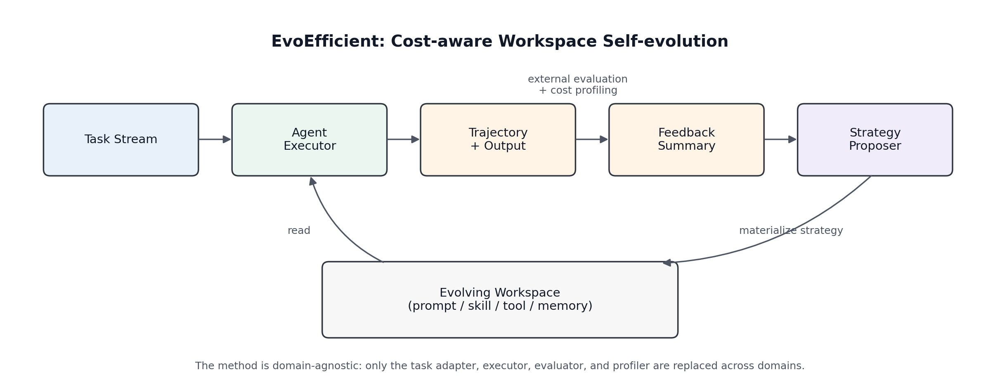
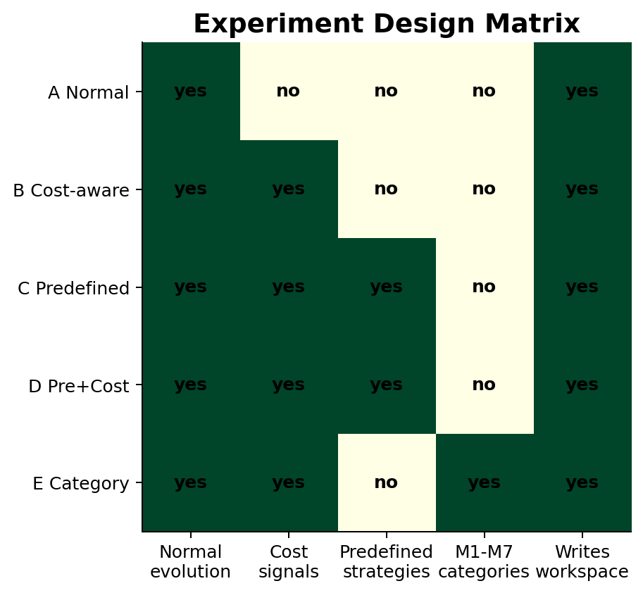
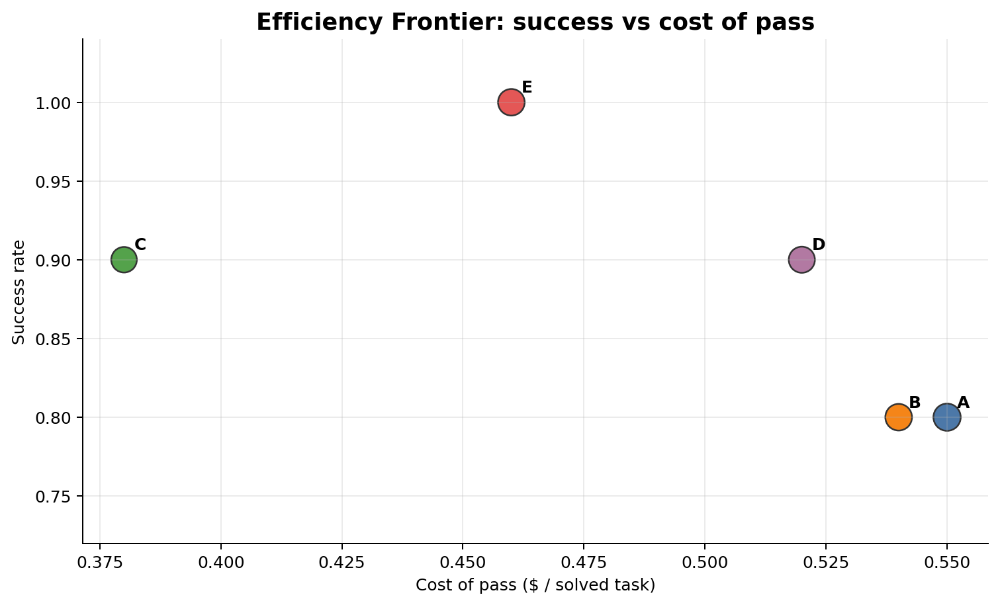
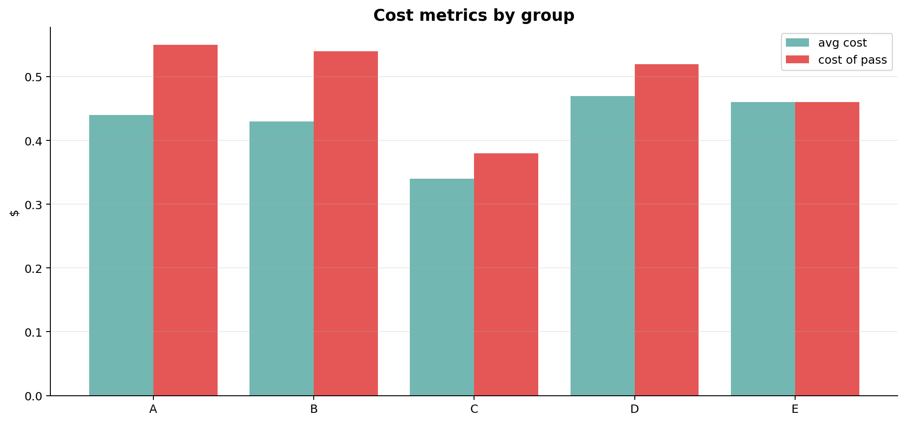
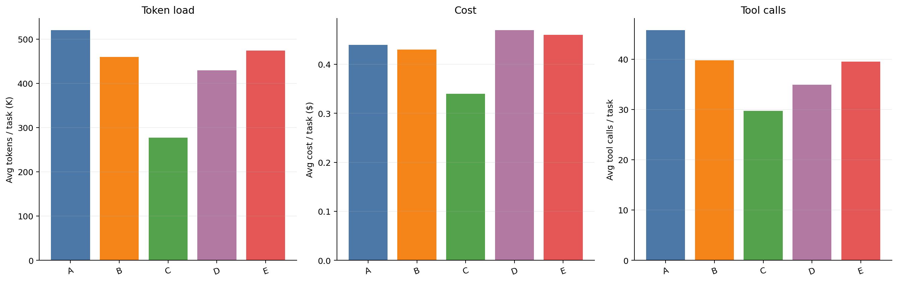
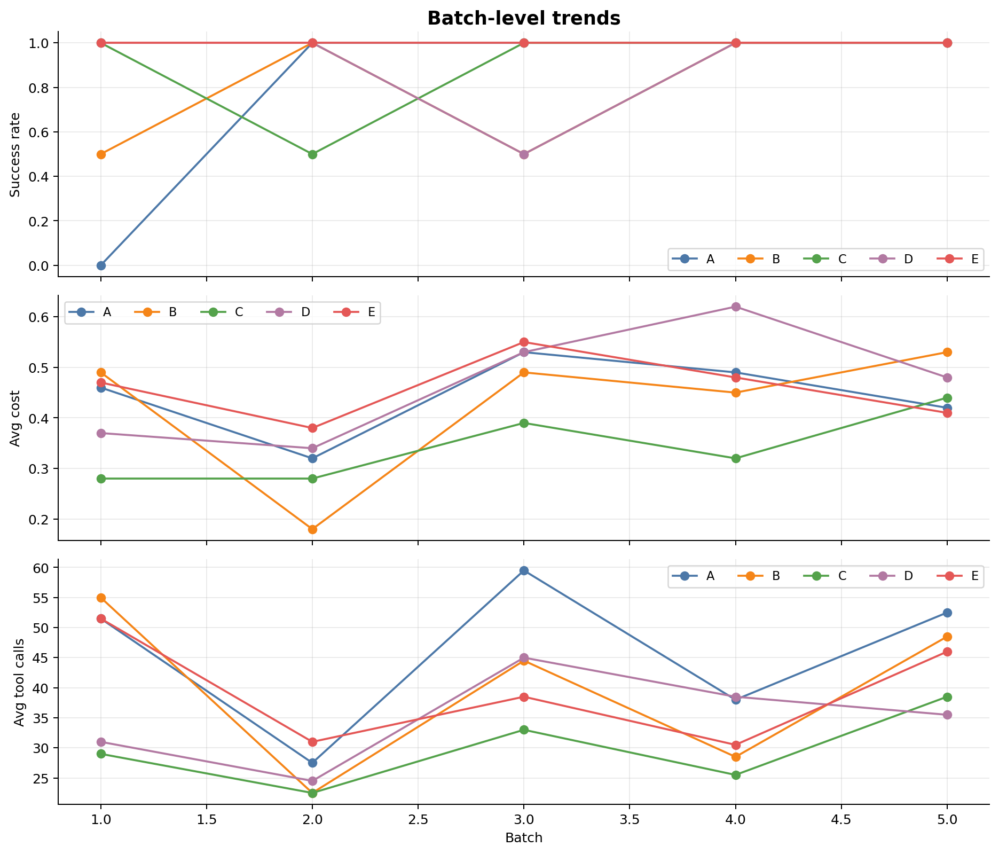
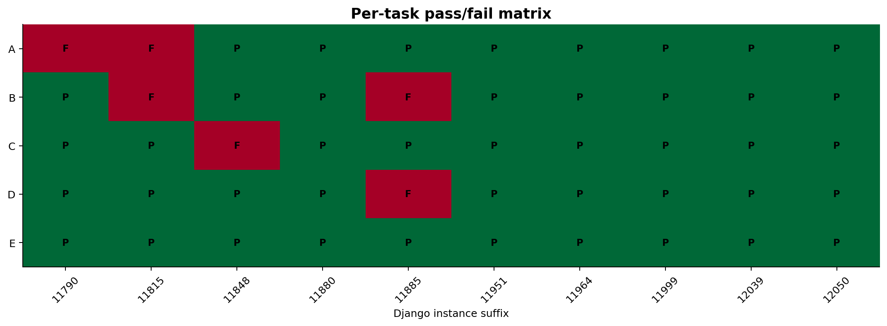
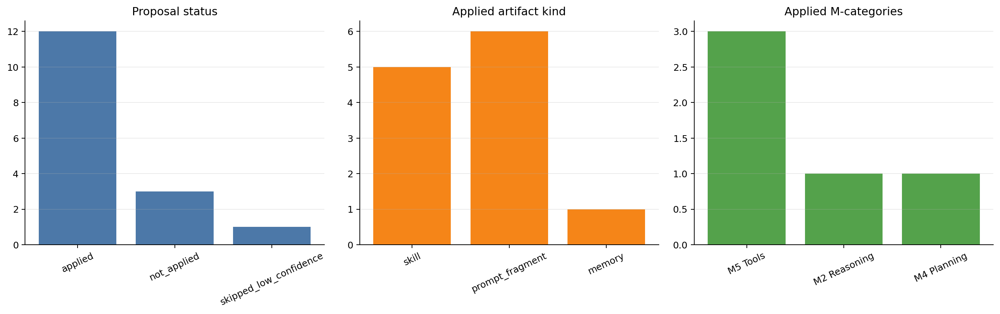
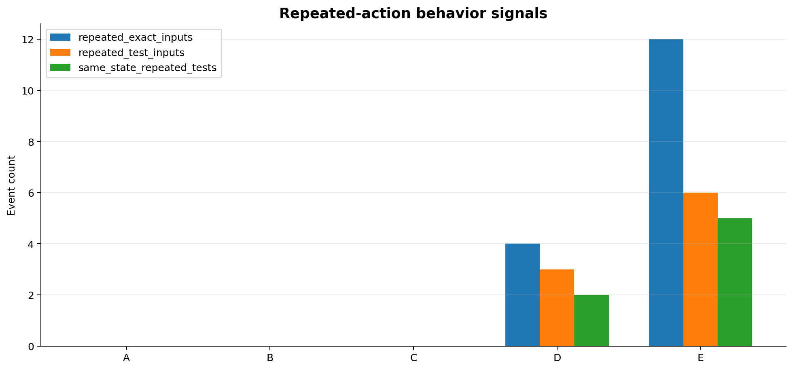

# 效率驱动的agent自进化

> 课题开始时间：2026\-7\-3
> 
> 参与人员：
> 
> 服务器：alinode2
> 
> GitHub：https://github\.com/DeepSoftwareAnalytics/EvolveEfficient
> 
> 

# **Abstract**

LLM Agent 的能力越来越强，但长程任务中的执行成本也越来越高：每一步都读入长上下文，每个任务都重新规划，相似任务重复搜索，简单步骤和困难步骤使用同样昂贵的推理预算，验证策略也常常偏保守。现有自进化 Agent 通常以任务成功率作为核心奖励，因此它们更容易学到“加法式改进”：多推理、多检查、多调用工具。这些策略可能提升成功率，但token、步骤数、工具调用数和延迟不一定降低，甚至可能因"过度推理"而增加。

我们提出 **EvoEfficient**，一个效率驱动的 Agent 自进化范式。它把进化目标从“最大化成功率”扩展为“在保持成功率的前提下最小化执行成本”。EvoEfficient 通过成本画像、瓶颈分析、效率策略库，让 Agent 从自身成功但低效的轨迹中学习“哪些步骤可以少做”。这些效率策略在以成功率为目标的进化中无法涌现，因为它们不一定提升正确性，只提升效率。

【实验和评测结果】。

# **Introduction**

LLM Agent 正在从单轮问答系统发展为长程任务求解系统。为了完成真实任务，Agent 需要读取大规模上下文、调用外部工具、与软件或网页环境交互、验证中间结果，并在失败后多轮修正。与此同时，自进化 Agent 通过“执行-评估-蒸馏”的闭环，将历史经验沉淀为 prompt、skill、tool 或 memory，使 Agent 能够在后续任务中复用经验，而不是完全依赖固定提示词或人工规则。

然而，能力提升也带来了新的部署瓶颈：Agent 的执行轨迹越来越长，成本越来越高。复杂 Agent 往往会重复读取相同上下文、为相似任务重新规划、重复调用低信息量工具、使用过于保守的验证流程，或者对简单步骤和困难步骤使用同样昂贵的推理预算。这些行为不仅是工程实现上的冗余，也会直接增加 token 消耗、API 费用、端到端延迟和环境交互成本。对于真实应用而言，一个 Agent 即使最终完成任务，如果每次都需要数十万 token、数十次工具调用和较长等待时间，也仍然难以规模化部署。

现有自进化 Agent 大多以任务成功率作为主要优化目标。这个目标是必要的，但并不充分：成功率更高并不意味着执行更省。当奖励只区分成功和失败时，进化过程天然偏向“加法式能力”，例如更多推理、更多检查、更多检索和更多工具调用。这些行为可能降低失败概率，却不会告诉 Agent 哪些步骤在任务完成后被证明是冗余的。换言之，能力知识回答的是“应该做什么”，而效率知识往往回答的是“什么可以不再做”。后者很难从单纯的成功率奖励中系统性涌现。

本文关注的问题是：Agent 能否通过自进化学到可复用的效率策略，从而在保持正确性的前提下“少做但仍做对”？这个问题的难点在于，简单最小化成本并不安全。Agent 可以通过提前停止、跳过证据收集、减少验证或提交不完整答案来降低成本，但这并不是真正的效率提升。因此，效率驱动的自进化必须是 success-first 的：系统首先依赖外部 evaluator 约束正确性，再利用成本信号和行为信号识别成功轨迹或有信息轨迹中的冗余行为。

为此，我们提出 **EvoEfficient**，一个效率驱动的 LLM Agent 自进化框架。EvoEfficient 在标准自进化闭环中显式加入三类反馈：正确性反馈、成本反馈和行为反馈。每个 batch 任务完成后，profiler 总结成本花在何处，strategy proposer 从轨迹和反馈中归纳候选效率策略，strategy materializer 再将被采纳的策略写回 Agent workspace，形成 prompt fragment、skill、tool 或 memory 等显式 artifact。后续任务会读取更新后的 workspace，从而复用已经形成的效率经验。

EvoEfficient 的一个重要设计目标是让效率自进化能够以**即插即用**的方式接入现有 Agent 系统。它不要求微调模型权重，也不要求重写 Agent 的内部策略，而是把 workspace 作为 Agent 与 Evolver 之间的进化接口。只要一个现有 Agent 能暴露 task executor、external evaluator 和 trajectory/cost profiler，EvoEfficient 就可以在其外部观察执行过程、生成效率策略，并通过 Agent 原本可读取的 prompt、skill、tool 或 memory 注入策略。这种设计使策略更容易审计、禁用、回滚和迁移，也使方法不必绑定到某一个具体 benchmark 或底座 Agent。

本文进一步区分两类效率知识来源。预定义策略来自人工设计，可作为强工程 baseline；自然涌现策略则从中性的成本摘要和行为摘要中生成，并且不向 proposer 暴露预定义策略名称或实现细节。这一区分使我们能够研究 Agent 是否真的可以从成本压力中发现效率行为，而不是仅仅复述或选择人工策略。为了在“不泄漏具体策略”的同时提供弱结构，我们还引入 M1-M7 效率 taxonomy，覆盖 context、reasoning、output、planning、tools、compilation 和 model routing 等成本维度。

我们在 SWE-bench Verified Mini 上实例化 EvoEfficient，并设置五组实验：普通自进化、成本感知自然涌现、预定义效率控制、预定义策略加成本反馈、以及类别种子成本感知自进化。当前 pilot 结果显示，相比普通自进化，成本感知自然涌现组在保持 80% 成功率的同时，将平均 token 降低 11.6%，平均工具调用从 45.8 降至 39.8；预定义控制组仍是最强成本 baseline，将 cost of pass 降低 30.9%；类别种子组达到 10/10 成功，并将 cost of pass 降低 16.4%，同时产生了被采纳的 emergent artifact，且至少有一个 emergent skill 在后续任务中被实际读取。这些结果表明，显式成本反馈能够改变 Agent 行为，而弱类别先验有助于形成更稳定的自然涌现效率策略。

本文的主要贡献如下：

1. 我们将 **效率驱动的 Agent 自进化**形式化为 success-first 优化问题，把正确性、成本和行为信号同时纳入进化目标，而不是只优化任务成功率。
2. 我们提出 **EvoEfficient**，通过 workspace 将成本感知反馈转化为显式、可复用、可审计的策略 artifact。
3. 我们设计了一个**即插即用的进化接口**，使现有 Agent 可以通过 executor、evaluator 和 profiler 抽象接入效率自进化，而无需模型微调或侵入式修改内部策略。
4. 我们提出区分 **自然涌现效率策略**与人工预定义策略的实验协议，包括策略泄漏控制、proposal 采纳记录和 artifact 级复用分析。
5. 我们在 SWE-bench Verified Mini 上给出 pilot 实验，展示成本感知和类别种子自进化能够降低单位成功成本、改变工具使用行为，并产生可复用的效率 artifact。

# **Related Work**

## **自进化Agent**

自进化Agent通过"执行\-评估\-蒸馏"循环持续改进：

|框架|进化机制|进化产物|进化目标|
|---|---|---|---|
|EvolveR \[1\]|离线蒸馏→在线交互→策略更新|策略原则库|任务成功率|
|ReasoningBank \[2\]|推理记忆积累与检索|推理记忆|任务成功率|
|CASCADE \[3\]|技能发现→验证→入库|技能库|任务成功率|
|STELLA \[4\]|工具创建\+模板积累|工具海洋\+模板库|任务成功率|
|AgentEvolver \[5\]|属性奖励驱动的经验进化|经验池|任务成功率|
|CSE \[6\]|受控自进化（多样化初始化\+遗传进化\+层次记忆）|优化模板|代码执行效率|
|ACE \[11\]|上下文工程（Generator\-Reflector\-Curator）|演化式Playbook|任务成功率|
|ADAMEM \[12\]|混合记忆架构\+步级适配|短期策略记忆|任务成功率|

**与EvoEfficient的区别**：上述框架（除CSE外）的进化目标均为任务成功率。CSE虽然优化代码执行效率，但其目标是算法代码的时间/空间复杂度，不是Agent任务执行的token/步骤效率。~~EvoEfficient是~~~~首个~~~~将Agent任务执行效率作为自进化内在驱动力的框架。~~

### agent框架

[自进化 Agent 框架全面汇总](https://qcnomrudhuku.feishu.cn/wiki/Ybdfw3KH7igIAekc2hGckyVanfd)[Agent Benchmark 评估的自进化Agent框架调研报告](https://qcnomrudhuku.feishu.cn/wiki/IbIWw7eKEiqnGXkwAlvcfbodnmf)

不同框架的差异，主要不在“是否会反思”，而在**进化对象**不同。


- **六类典型框架**

- **标准自进化闭环**

自进化框架通常可以抽象成五步：


对应到常见框架：


## **2\.2 Agent效率优化**

[效率驱动Agent自进化：效率策略全面调研](https://qcnomrudhuku.feishu.cn/wiki/AdSwwF1ljiWPvfkiNWEck432nGh)

|方法|优化方式|优化目标|是否自进化|是否修改模型权重|
|---|---|---|---|---|
|DEPO \[7\]|偏好优化（KTO\+efficiency bonus）|step\-level \+ trajectory\-level效率|否|是|
|Ares \[8\]|外部路由器控制推理深度|推理token减少|否|否|
|APC \[10\]|缓存计划模板\+小模型适配|服务成本降低|否|否|
|AgenticCache \[13\]|缓存计划转移\+异步LLM验证|具身Agent延迟/成本|否|否|
|GEPA \[14\]|遗传\-帕累托提示进化|含成本维度的多目标|否|否|
|Compiled AI \[15\]|LLM生成确定性代码替代推理|token消耗降低|否|否|

**与EvoEfficient的区别**：

- DEPO修改模型权重实现一次性优化，EvoEfficient不修改权重，通过自进化持续优化

- APC/AgenticCache是静态缓存系统，Agent自身不知道何时/如何缓存；EvoEfficient让Agent通过进化自主学会缓存策略

- Ares的外部路由器是人工设计的，EvoEfficient的自适应推理是进化发现的

- Compiled AI是离线编译，EvoEfficient是在线编译——Agent自主决定何时编译、编译什么

# **3. Method**

本节采用 top-down 的方式介绍 EvoEfficient：先给出方法的一句话定义，再解释整体架构，最后展开每个模块为什么这样设计。为了让不同领域的读者都能理解，本节不把方法绑定到某一个具体 benchmark，也不展开运行参数、日志目录、具体任务字段等实验细节；这些内容放在第 4 节 Experiment 中说明。

EvoEfficient 的核心思想是：

> 将 Agent 的执行过程转化为“正确性反馈 + 成本反馈 + 行为反馈”，再把这些反馈沉淀为可复用、可审计、可迁移的策略 artifact，使 Agent 在后续任务中学会以更低成本完成任务。

换言之，EvoEfficient 不是让 Agent 单纯“更努力地做任务”，而是让 Agent 学会“哪些步骤值得做，哪些步骤可以少做，哪些经验可以复用”。这种设计面向的是通用工具型 Agent，因此不仅适用于软件工程任务，也可以扩展到网页操作、数据库查询、终端任务、问答、数据分析、机器人流程控制、GUI 操作等场景。

## **3.1 Method Overview**

EvoEfficient 解决的是一个 success-first 的效率优化问题：Agent 首先必须保持任务正确性，在此基础上减少不必要的 token、工具调用、模型调用、验证轮次和环境交互。它不直接训练模型权重，而是在 Agent 外部维护一个可演化的 workspace。Agent 使用 workspace 完成任务；Evolver 读取任务后的反馈，并把新策略写回 workspace；后续 Agent 再从更新后的 workspace 中受益。

整体流程如下图所示。该图刻意保持简单，参考顶会论文中常见的 high-level pipeline 风格：只展示信息流和模块关系，不把实验组、代码路径、日志文件等实现细节放进方法图。



图中的闭环包含五个核心步骤：

1. **Execute**：Agent 从 workspace 读取 prompt、tools、skills 和 memory，完成一批任务。
2. **Evaluate**：外部 evaluator 判断任务输出是否正确，避免 Agent 自评带来的偏差。
3. **Profile**：profiler 从轨迹中抽取成本和行为信号，找出低效模式。
4. **Propose**：strategy proposer 根据反馈摘要提出可复用的效率策略。
5. **Materialize**：strategy materializer 将策略写回 workspace，让策略影响后续任务。

这个闭环的关键不是某个单独模块，而是“反馈可以变成可执行经验”。如果反馈只停留在日志中，Agent 下一次任务不会自然改变行为；如果策略只存在于模型回答中，也很难复用、审计和回滚。EvoEfficient 因此把策略落到 workspace 中，使自进化过程具有明确的状态载体。

## **3.2 Problem Formulation**

给定一个任务序列：

```text
D = {x_1, x_2, ..., x_N}
```

每个任务 `x_i` 可以来自任意领域，只需要满足三个基本条件：

| 条件 | 含义 | 示例 |
|---|---|---|
| Task Input | Agent 能读取的任务描述或结构化输入 | issue、网页目标、问答问题、数据库查询需求 |
| Action Space | Agent 可使用的工具或环境动作 | shell、browser、search、SQL、API、GUI action |
| Evaluation Signal | 判断任务是否完成的外部标准 | 单元测试、状态检查、答案匹配、规则评测、人工/模型 judge |

Agent 在任务上产生轨迹：

```text
tau_i = (s_i, a_1, o_1, a_2, o_2, ..., a_T, o_T, y_i)
```

其中 `s_i` 是任务初始状态，`a_t` 是 Agent 的动作，`o_t` 是环境观察，`y_i` 是最终输出。不同领域的 `y_i` 形式不同：可以是代码补丁、网页操作结果、结构化答案、数据分析报告、数据库查询结果或 GUI 终态。

外部 evaluator 返回正确性反馈：

```text
r_i = Evaluator(x_i, y_i)
```

成本分析器返回成本向量：

```text
c_i = (tokens_i, calls_i, turns_i, latency_i, money_i, context_i, ...)
```

EvoEfficient 的目标不是单独最小化成本，因为一个什么都不做的 Agent 成本最低但没有价值。我们采用 success-first 的目标：

```text
maximize     task_success
minimize     execution_cost
subject to   correctness is not sacrificed by cost reduction
```

因此，EvoEfficient 中所有效率策略都必须回答两个问题：

1. **它节省什么成本？** 例如 token、工具调用、重复验证、上下文长度或昂贵模型调用。
2. **它在什么条件下不能触发？** 例如证据不足、任务高风险、外部状态已经变化、需要额外验证时。

这种 formulation 的好处是让“效率”从一个模糊的工程目标变成可度量、可比较、可优化的学习信号。

## **3.3 Design Principles**

EvoEfficient 遵循四个设计原则。

**Principle 1: Correctness First**

效率优化不能变成“少做事所以更便宜”。所有策略必须以外部评测结果为约束。系统允许减少冗余步骤，但不鼓励跳过必要证据、必要验证或必要环境交互。因此，策略不仅要描述 expected savings，还要描述 correctness risk 和 do-not-trigger condition。

**Principle 2: Learn From Trajectories, Not From Hand-written Rules Only**

人工规则可以提供强 baseline，但如果系统只能执行人工预设规则，它就不是自进化。EvoEfficient 更关注从历史轨迹中自动发现低效模式。例如，Agent 可能在多个任务中反复搜索无关信息、反复读取超长上下文、在环境状态未变化时重复执行同一检查，或者在接近步数上限时仍继续探索。这些模式应该由系统从轨迹中观察到，再被总结为策略。

**Principle 3: Make Strategies Explicit**

策略必须以显式 artifact 的形式存在，而不是隐藏在一次模型调用的上下文中。显式策略有三个优势：第一，可以被后续任务复用；第二，可以被人类检查和回滚；第三，可以跨 benchmark 迁移。对于 Agent 系统而言，这比只把经验保存在 prompt 历史里更可靠。

**Principle 4: Keep the Method Domain-agnostic**

方法层不假设任务一定是代码修复、网页操作或问答。EvoEfficient 只依赖三个抽象接口：task executor、external evaluator 和 trajectory profiler。只要新领域能提供这三个接口，就可以接入同一个效率自进化闭环。

## **3.4 Architecture**

EvoEfficient 可以理解为三层架构：执行层、观察层和进化层。

| Layer | 作用 | 输入 | 输出 |
|---|---|---|---|
| Execution Layer | 使用当前 workspace 完成任务 | task + workspace | trajectory + task output |
| Observation Layer | 将执行过程转化为可学习信号 | trajectory + evaluator result | correctness/cost/behavior summary |
| Evolution Layer | 生成并落地新策略 | feedback summary + current workspace | updated workspace |

这种分层设计有两个原因。

第一，它把“做任务”和“改进做任务的方法”分开。Agent executor 专注于当前任务，evolver 专注于跨任务规律。这样可以避免 Agent 在单个任务中为了自我修改而偏离主目标。

第二，它把领域相关部分限制在执行层和评测层。比如网页任务需要 browser action，代码任务需要 shell 和测试环境，数据库任务需要 SQL executor；但观察层和进化层只处理统一的轨迹、成本和策略表示，因此可以跨领域复用。

## **3.5 Workspace as the Evolution Interface**

EvoEfficient 选择以 workspace 作为 Agent 与 Evolver 的共享接口。workspace 可以被理解为 Agent 的“外部认知状态”，其中包含 prompt、skills、tools、memory 和策略配置。Agent 不需要知道 evolver 如何生成策略；evolver 也不需要直接侵入 Agent 的内部推理过程。二者通过 workspace 解耦。

```text
Workspace
  prompts/      short behavioral constraints
  skills/       reusable procedures and playbooks
  tools/        executable helper functions
  memory/       cross-task experience
  metadata/     provenance, confidence, risk, usage records
```

这种接口的设计原因如下：

| 需求 | 为什么 workspace 合适 |
|---|---|
| 可复用 | 新策略写入后，后续任务可直接读取 |
| 可审计 | 每个策略都有明确文件、来源、时间和触发条件 |
| 可回滚 | 低质量策略可以删除或禁用 |
| 可迁移 | 与具体任务样本解耦，可以迁移到其它领域 |
| 可组合 | prompt、skill、tool、memory 可以表达不同粒度的策略 |

从方法角度看，workspace 是 EvoEfficient 区别于普通提示词优化的重要部分。普通提示词优化通常只修改一段 instruction；EvoEfficient 则允许策略根据其性质落到不同载体中：短规则进入 prompt fragment，长流程进入 skill，确定性操作进入 tool，跨任务经验进入 memory。

## **3.6 Feedback Abstraction**

为了让不同领域都能使用同一个进化闭环，EvoEfficient 将任务后的反馈抽象为三类信号。

| 信号 | 回答的问题 | 典型来源 |
|---|---|---|
| Correctness Signal | 任务是否做对？哪里失败？ | evaluator、judge、test、state checker |
| Cost Signal | 做这件事花了多少资源？ | token usage、tool calls、latency、API cost |
| Behavior Signal | 成本为什么高？行为模式是什么？ | trajectory、action sequence、observation length |

其中 behavior signal 是连接“成本高”和“如何改”的桥梁。只知道 token 高，并不能直接推出策略；但如果知道 token 高是因为重复读取长观察、无效搜索、长时间不提交候选输出，系统就可以提出更具体的策略。

常见行为信号包括：

| 行为模式 | 可解释含义 | 潜在策略方向 |
|---|---|---|
| Repeated Action | 多次执行相同或高度相似动作 | 去重、缓存、状态变化检查 |
| Long Context Growth | 上下文不断膨胀 | 摘要、检索、上下文选择 |
| Late First Attempt | 很晚才产生第一个候选输出 | 阶段性 checkpoint、早期草案 |
| Unbounded Exploration | 长时间搜索但没有收敛 | 探索预算、停止条件、目标重写 |
| Over-verification | 反复验证低风险部分 | 分层验证、最小充分验证 |
| Tool Misuse | 选择了昂贵或低信息量工具 | 工具选择策略、路由规则 |

EvoEfficient 不要求每个领域都具备完全相同的行为信号。不同领域可以定义自己的 profiler，只要最后输出可解释的成本摘要和行为摘要即可。

## **3.7 Cost-aware Strategy Generation**

strategy proposer 的任务是把反馈摘要转化为策略候选。这里的关键设计是：输入给 proposer 的不是人工策略列表，而是任务后的中性摘要。这样可以观察策略是否从成本和行为证据中自然产生，而不是简单复述预设规则。

proposer 生成的策略需要包含以下信息：

| 字段 | 作用 |
|---|---|
| Name | 策略的可追踪名称 |
| Motivation | 该策略解决什么低效模式 |
| Trigger | 什么时候应该启用 |
| Do-not-trigger | 什么情况下不应该启用 |
| Expected Savings | 预计节省哪类成本 |
| Correctness Risk | 可能伤害正确性的方式 |
| Evidence | 来自哪些轨迹或摘要信号 |
| Artifact Type | 应该写成 prompt、skill、tool 还是 memory |

这样设计有三个原因。

第一，trigger 和 do-not-trigger 让策略具有边界。没有边界的效率策略容易变成危险的全局规则，例如“少测试”“少读上下文”“尽快输出”。这些规则虽然便宜，但可能降低正确性。

第二，evidence 要求策略绑定真实轨迹。策略不是泛泛的优化建议，而是对已观察低效行为的归纳。

第三，artifact type 让策略可以落地。一个策略如果不能被写入 workspace，并被后续任务读到或调用，就无法构成真正的自进化。

## **3.8 Strategy Materialization**

策略生成后不会直接改变 Agent 行为，而是先经过 materialization。materializer 负责把自然语言策略转换成 workspace 中的结构化 artifact。

| Artifact | 适合表达什么策略 | 例子 |
|---|---|---|
| Prompt Fragment | 简短、稳定、全局适用的行为约束 | “重复执行昂贵动作前先确认状态是否变化” |
| Skill | 较长的流程、检查清单或领域 workflow | “遇到失败后按证据定位、最小验证、再扩展搜索” |
| Tool | 可确定执行的机械操作 | 去重、裁剪、摘要、格式检查、缓存查询 |
| Memory | 低频但有迁移价值的经验 | “某类任务通常先检查输入格式再运行昂贵评测” |

materialization 的核心不是简单保存文本，而是把策略变成“后续 Agent 可使用的能力”。因此每个策略 artifact 应该包含来源、触发条件、预期收益、风险说明和版本信息。这使系统能够追踪策略生命周期：何时产生、何时生效、是否被后续任务使用、是否需要回滚。

## **3.9 Efficiency Taxonomy**

为了让成本反馈更容易组织，EvoEfficient 使用一套通用效率 taxonomy。taxonomy 的作用不是给 Agent 具体答案，而是提供分析维度，帮助系统把不同低效现象归类。

| 类别 | 优化对象 | 适用领域示例 |
|---|---|---|
| M1 Context Efficiency | 输入上下文、记忆读取、证据选择 | 长文档 QA、代码理解、网页导航 |
| M2 Reasoning Efficiency | 推理轮次、反思长度、重复分析 | 多步问答、规划任务、调试任务 |
| M3 Output Efficiency | 输出长度、观察压缩、报告结构 | 数据分析、日志阅读、命令输出处理 |
| M4 Planning Efficiency | 计划生成、重规划、阶段控制 | 复杂任务、长链工具调用 |
| M5 Tool Efficiency | 工具选择、调用次数、重复动作 | browser、shell、database、API agent |
| M6 Skill Compilation | 经验复用、流程固化、模板化 | 跨任务 workflow、常见失败恢复 |
| M7 Model Routing | 模型选择、难度判断、成本路由 | 多模型系统、简单/复杂任务分流 |

taxonomy 的设计需要保持抽象。它不应该告诉 Agent “使用某个具体人工策略”，而是告诉系统“可以从哪些成本维度观察效率”。这使它可以跨领域迁移：网页任务中的重复点击、代码任务中的重复测试、数据库任务中的重复查询，都可以归入 M5 Tool Efficiency；长网页文本、长日志、长代码文件都可以归入 M1 Context Efficiency。

## **3.10 Safety and Governance**

效率自进化存在一个天然风险：系统可能学会减少必要步骤，从而降低正确性。因此 EvoEfficient 在方法层引入治理机制，而不是只在实验后分析。

主要安全约束包括：

| 机制 | 目的 |
|---|---|
| External Evaluation | 使用外部评测约束策略，避免自评偏差 |
| Success-first Objective | 成本下降不能以明显正确性下降为代价 |
| Trigger Boundary | 策略必须说明适用条件 |
| Risk Annotation | 策略必须说明可能伤害正确性的方式 |
| Artifact Provenance | 记录策略来源和证据，便于审计 |
| Limited Update Scope | 每轮只接受有限数量策略，降低污染风险 |
| Rollbackability | 策略以文件或配置存在，可禁用或回滚 |

这些机制使 EvoEfficient 更接近可部署系统，而不是一次性 prompt engineering。尤其在高风险任务中，系统不能只追求更低成本，还必须解释为什么某个省略步骤是安全的。

## **3.11 Relation to Predefined Strategies**

EvoEfficient 的主线是从轨迹和成本反馈中产生策略，而不是依赖人工策略表。人工预定义策略可以作为对照、初始化或工程 baseline，但不应被视为方法本身的核心。

二者的区别如下：

| 类型 | 来源 | 作用 |
|---|---|---|
| Emergent Strategy | 从执行轨迹和成本反馈中归纳 | 研究 Agent 是否能自发发现效率改进 |
| Predefined Strategy | 人工提前编写 | 提供对照、上限或工程 fallback |

因此，“自然涌现策略”和“预定义策略”并不矛盾，只要二者在方法和实验中分清角色。方法上，EvoEfficient 支持两种策略载体；研究问题上，自然涌现策略才是核心对象；实验上，预定义策略用于比较“自动发现的策略”和“人工设计的策略”之间的差距。

## **3.12 Why This Design Generalizes**

EvoEfficient 的可迁移性来自三个抽象。

第一，任务输出是抽象的。方法不要求输出一定是代码补丁，也可以是答案、报告、环境状态、结构化计划或操作序列。

第二，评测器是抽象的。不同领域可以使用不同 evaluator，只要能提供正确性或质量反馈。

第三，成本信号是抽象的。token、工具调用、延迟、API 费用、上下文长度、环境交互次数都可以作为成本；具体指标可以随领域替换。

因此，在新领域中接入 EvoEfficient 通常只需要替换三类组件：

| 组件 | 需要适配什么 |
|---|---|
| Task Adapter | 把领域数据转成统一 task |
| Executor | 定义 Agent 可以执行的动作和工具 |
| Evaluator / Profiler | 给出正确性、成本和行为反馈 |

workspace、strategy proposer、strategy materializer 和安全治理逻辑可以保持基本一致。

## **3.13 Method Summary**

EvoEfficient 可以总结为一个通用的效率驱动自进化框架：

```text
Run agent -> observe correctness and cost -> infer reusable efficiency strategy
          -> materialize strategy into workspace -> improve future agent behavior
```

与普通自进化相比，它的核心创新在于三点：

1. **从结果反馈扩展到成本反馈**：不仅看任务是否成功，也看成功背后的资源消耗。
2. **从单次经验扩展到可复用策略**：将低效行为总结为 prompt、skill、tool 或 memory。
3. **从领域专用优化扩展到通用 Agent 优化**：通过 task/evaluator/profiler 抽象，使方法可以迁移到多种 Agent 场景。

# **4. Experiment**

本节描述已经完成的 `emergent_efficiency` 实验，而不是未来计划。实验代码位于：

```text
examples/swe_examples_new/emergent_efficiency/run_emergent_efficiency.py
```

主要结果和可视化文档位于：

```text
examples/swe_examples_new/emergent_efficiency/visual_docs/
logs/emergent_efficiency/five_run_emergent_efficiency_report_20260903_212446/
```

## **4.1 Research Questions**

当前实验围绕四个研究问题展开。

**RQ1：效率驱动自进化是否能在保持成功率的同时降低执行成本？**

比较普通自进化 A 组和成本感知自然涌现 B/E 组，观察 success rate、avg tokens、avg cost、cost of pass 和 tool calls 的变化。

**RQ2：预定义效率策略与自然涌现策略相比如何？**

比较 C 组预定义控制组与 B/E 组自然涌现组，判断人工策略是否仍然是成本上限，以及自然涌现策略距离人工策略有多大差距。

**RQ3：自然涌现策略是否真的出现、落地并被复用？**

检查 B/D/E 组的 `proposals.jsonl`、`proposal_adoption.json`、workspace artifact、system prompt 和 skill usage，判断 proposal 是否不仅被生成，而且进入后续任务。

**RQ4：弱类别先验是否有助于效率策略形成？**

比较 B 组和 E 组。B 组只给成本信号；E 组额外给 M1-M7 抽象成本类别。若 E 组更稳定或 proposal 更结构化，说明弱类别先验有帮助。

## **4.2 Experimental Design**

实验设置五组。当前 pilot 每组使用 10 个任务，分 5 个 batch，每个 batch 2 个任务，并行度为 2。本文报告的数值结果来自 SWE-bench Verified Mini 这一代码修复 benchmark，但实验设计本身面向通用 Agent 任务：只要 benchmark 能提供 `Task`、可执行环境、评测器和轨迹记录，就可以接入同一套 EvoEfficient pipeline。



| 组别 | 模式 | 目的 | 是否有普通自进化 | 是否给成本反馈 | 是否启用预定义策略 | 是否给 M1-M7 类别 |
|---|---|---|---|---|---|---|
| A | `normal-evolve` | 普通自进化基线 | 是 | 否 | 否 | 否 |
| B | `cost-aware` | 主自然涌现实验 | 是 | 是 | 否 | 否 |
| C | `predefined-control` | 手工效率策略控制组 | 是 | 是 | 是 | 否 |
| D | `predefined-cost-aware` | 手工策略 + 成本反馈增量组 | 是 | 是 | 是 | 否 |
| E | `category-seeded-cost-aware` | M1-M7 弱类别先验组 | 是 | 是 | 否 | 是 |

五组的设计逻辑如下：

1. A vs B：测量“中性成本反馈”的增量作用。
2. A vs E：测量“中性成本反馈 + 弱类别先验”的增量作用。
3. B vs E：测量 M1-M7 taxonomy 是否帮助 proposal 结构化。
4. A/B/E vs C：比较自然涌现与人工预定义策略上限。
5. C vs D：测量已有手工策略上继续做 cost-aware proposal 是否有增量价值。

## **4.3 Dataset and Task Setup**

当前 pilot 数据集为：

```text
MariusHobbhahn/swe-bench-verified-mini
```

选择该数据集的原因是它提供了可自动评测的真实长程任务：Agent 需要阅读上下文、调用工具、修改 artifact、验证输出并提交最终结果，适合观察 token、工具调用、重复验证和成本变化。该数据集只是当前阶段的第一个实例化 benchmark，后续可以扩展到 WebShop、TAU-bench、OSWorld、HotpotQA、Terminal-Bench、MCP 工具任务等其它任务类型。

为了保持复现性，当前五组对比使用前 10 个 test split 任务，均来自 Django 代码修复子集：

| 任务 ID | 说明 |
|---|---|
| `django__django-11790` | Django bug fixing task |
| `django__django-11815` | Django bug fixing task |
| `django__django-11848` | Django bug fixing task |
| `django__django-11880` | Django bug fixing task |
| `django__django-11885` | Django bug fixing task |
| `django__django-11951` | Django bug fixing task |
| `django__django-11964` | Django bug fixing task |
| `django__django-11999` | Django bug fixing task |
| `django__django-12039` | Django bug fixing task |
| `django__django-12050` | Django bug fixing task |

在这个 pilot 中，每个任务包含 issue statement、base commit、Docker image、test patch、FAIL_TO_PASS/PASS_TO_PASS。Agent 不直接获得参考 patch；参考 patch 只作为数据集 metadata 保存。若迁移到其它数据集，这些字段会替换为对应 benchmark 的环境状态、目标约束、可用工具、标准答案或外部评测器。

## **4.4 Implementation Details**

实验运行参数：

| 参数 | 值 |
|---|---|
| `--limit` | 10 |
| `--batch-size` | 2 |
| `--parallel` | 2 |
| `--max-steps` | 60 |
| `--window-size` | 40 |
| `--model-id` | `us.anthropic.claude-opus-4-6-v1` |
| `--evolver-temperature` | 0.2 |
| `--evolver-max-tokens` | 8192 |
| `--max-proposals-per-batch` | 2 |
| seed workspace | 当前 pilot 为 `seed_workspaces/swe`；其它 benchmark 可替换为对应 workspace |

示例命令：

```bash
python examples/swe_examples_new/emergent_efficiency/run_emergent_efficiency.py \
  --mode category-seeded-cost-aware \
  --category-seed basic-efficiency \
  --limit 10 \
  --batch-size 2 \
  --parallel 2 \
  --max-steps 60 \
  --output-dir logs/emergent_efficiency/category_seeded_cost_aware
```

预定义控制组默认启用：

```text
observation_masking
plan_template_cache
adaptive_tool_trimming
stagnation_rescue_stop
skill_compilation
```

其中 `verbatim_compaction` 默认不启用，避免过强压缩带来额外变量。

## **4.5 Input and Output Flow**

每个任务的数据流如下：

```text
dataset row
  -> Task(id, input, metadata)
  -> task agent reads current workspace
  -> tool-use trajectory in benchmark environment
  -> submitted task output
  -> benchmark evaluator scores the output
  -> Feedback(success, score, detail)
  -> result with usage and behavior stats
  -> Observation(task, trajectory, feedback)
  -> GuidedSynthesis normal evolution
  -> optional cost-aware proposer
  -> proposed artifacts written to workspace
  -> next batch uses updated workspace
```

主要输出文件：

| 文件 | 内容 | 用途 |
|---|---|---|
| `results.json` | 每个任务的输出、success、usage、steps | 单任务复盘 |
| `summary.csv` | batch 和 overall 指标 | 横向比较、画图 |
| `behavior_stats.json` | 重复命令/重复测试等行为信号 | 分析是否真的减少冗余 |
| `patches/*.diff` / task artifacts | 当前 SWE pilot 保存 patch；其它 benchmark 可保存答案、轨迹、网页状态或操作日志 |
| `conversations/*.json` | 完整对话轨迹 | 深入分析 Agent 行为 |
| `system_prompts/*.md` | 实际 system prompt | 验证 prompt fragment 是否可见 |
| `emergence/proposals.jsonl` | proposer 输入、输出和解析状态 | 分析 emergent proposal |
| `emergence/proposal_adoption.json` | proposal 是否写入 workspace | 分析采纳率 |
| `emergence/leakage_audit.json` | 策略名泄漏检查 | 保证自然涌现组可信 |
| `workspace/` | 最终演化后的 workspace | 复用和迁移策略 |

## **4.6 Metrics**

成功率指标：

| 指标 | 定义 |
|---|---|
| `success` | 通过 benchmark 外部评测的任务数 |
| `success_rate` | `success / tasks` |
| `score_sum` | 任务分数总和 |

效率指标：

| 指标 | 定义 | 解释 |
|---|---|---|
| `avg_tokens` | 平均 `input_tokens + output_tokens` | 主要 token 压力 |
| `avg_cost` | 平均总成本 | 包含 input/output/cache/route |
| `cost_of_pass` | `total_cost / successful_tasks` | 单位成功成本，核心指标 |
| `avg_tool_calls` | 平均工具调用数 | 环境交互效率 |
| `wall_time` | 总运行时间 | 端到端延迟 |
| `max_input_tokens_per_turn` | 最大单轮输入 token | 上下文膨胀风险 |

行为指标：

| 指标 | 定义 |
|---|---|
| `repeated_exact_inputs` | 完全重复工具输入次数 |
| `repeated_test_inputs` | 重复测试命令次数 |
| `same_state_repeated_tests` | 未改代码状态下重复同一测试 |
| `post_edit_repeated_tests` | 编辑后重复同一测试 |
| `prompt_fragment_visible_tasks` | emergent prompt fragment 进入 system prompt 的任务数 |
| `emergent_skill_calls` | 后续任务实际读取 emergent skill 的次数 |

## **4.7 Main Results**

主结果来自：

```text
logs/emergent_efficiency/five_run_emergent_efficiency_report_20260903_212446/overall_comparison.csv
```

| 组别 | 成功数 | 成功率 | avg tokens | avg cost | cost of pass | tool calls | avg tool calls |
|---|---:|---:|---:|---:|---:|---:|---:|
| A Normal self-evolve | 8/10 | 80% | 520,335 | $0.44 | $0.55 | 458 | 45.8 |
| B Cost-aware emergence | 8/10 | 80% | 459,870 | $0.43 | $0.54 | 398 | 39.8 |
| C Predefined control | 9/10 | 90% | 277,309 | $0.34 | $0.38 | 297 | 29.7 |
| D Predefined + cost-aware | 9/10 | 90% | 429,633 | $0.47 | $0.52 | 349 | 34.9 |
| E Category seeded | 10/10 | 100% | 474,080 | $0.46 | $0.46 | 395 | 39.5 |



主要结论：

1. **C 组成本最低**：预定义策略控制组取得最低 `avg_cost=$0.34` 和最低 `cost_of_pass=$0.38`，说明人工策略仍然是强工程上限。
2. **E 组成功率最高**：类别种子组达到 10/10 成功，`cost_of_pass=$0.46`，比 A 组低约 16.4%。
3. **B 组降低成本但未提高成功率**：B 相对 A 降低 `avg_tokens` 和 `avg_tool_calls`，但成功率仍为 80%，说明成本反馈能改变行为，但没有稳定提高正确性。
4. **D 组不是简单叠加收益**：D 组在已有预定义策略上加入 proposer，成功率 90%，但 `avg_cost` 高于 C，说明额外 prompt/proposal 可能带来干扰或开销。





相对 A 组变化：

| 对比 | avg tokens 变化 | avg cost 变化 | cost of pass 变化 |
|---|---:|---:|---:|
| B vs A | -11.6% | -2.3% | -1.8% |
| C vs A | -46.7% | -22.7% | -30.9% |
| D vs A | -17.4% | +6.8% | -5.5% |
| E vs A | -8.9% | +4.5% | -16.4% |

解释：E 组的 `avg_cost` 比 A 略高，但由于成功率从 80% 提升到 100%，`cost_of_pass` 明显下降。这说明效率不能只看平均成本，还要看单位成功成本。

## **4.8 Batch-level Analysis**



当前 pilot 中，每组 10 个任务被分成 5 个 batch。batch 趋势揭示了策略随时间进入 workspace 后的变化。

| 组别 | batch 现象 |
|---|---|
| A | Batch 1 为 0/2，后续 batch 全部成功，说明普通自进化初期不稳定 |
| B | Batch 1 和 Batch 3 各有失败，后续能降低工具调用但正确性不稳 |
| C | 整体工具调用最低，预定义策略对成本控制最强 |
| D | Batch 3 出现失败且成本较高，说明预定义策略与 proposer 不一定单调叠加 |
| E | 5 个 batch 全部成功，是当前自然涌现设置中最稳定的组 |

这说明自然涌现策略的效果不是立即出现的，而是通过 batch 间写入 workspace 后逐步影响后续任务。

## **4.9 Per-task Success Analysis**



任务级别通过情况：

| 任务 | 失败组 |
|---|---|
| `django__django-11790` | A |
| `django__django-11815` | A、B |
| `django__django-11848` | C |
| `django__django-11885` | B、D |
| 其他 6 个任务 | 五组全部成功 |

观察：

1. A 组失败集中在早期 batch，说明没有成本反馈和类别先验时，普通自进化起步不稳。
2. B 组在 `django__django-11815`、`django__django-11885` 失败，说明仅靠成本反馈可能让 Agent 更省，但未必更稳。
3. C 组虽然成本最低，但在 `django__django-11848` 失败，说明手工策略可能在某些任务上改变了信息获取路径。
4. E 组 10 个任务全部成功，说明 M1-M7 弱类别先验提供了有用结构。

## **4.10 Emergent Proposal Analysis**

proposal 统计来自：

```text
logs/emergent_efficiency/five_run_emergent_efficiency_report_20260903_212446/proposal_catalog.csv
```



| 组别 | proposal reports | proposal count | adopted count | 主要 artifact |
|---|---:|---:|---:|---|
| B | 4 | 7 | 6 | skill、prompt fragment |
| D | 4 | 4 | 3 | prompt fragment |
| E | 4 | 5 | 3 | memory、prompt fragment、skill |

B 组生成的代表性策略：

下表中的策略名称来自当前代码修复 pilot，因此部分名称包含 test、Django、patch 等领域词。它们在方法上对应的是更通用的效率行为，例如“避免重复验证”“先读最相关证据”“限制无效外部检索”“在生成最终输出前做最小验证”。迁移到其它数据集时，proposal 名称和触发条件会随任务形态变化。

| 名称 | 类型 | 作用 |
|---|---|---|
| `rerun_identical_probe_only_after_change` | skill | 状态未变时不重复执行相同 probe |
| `narrow_test_reruns_after_fix` | skill | 修复迭代中优先运行最小测试目标 |
| `scoped_reads_with_grep` | skill | 先 grep 定位，再读取小范围上下文 |
| `first_edit_checkpoint` | prompt fragment | 防止长期搜索却迟迟不编辑 |
| `deduplicate_repeated_test_runs` | skill | 去重未改变状态下的重复测试 |
| `consolidate_environment_setup_and_exploratory_snippets` | prompt fragment | 合并重复环境 setup 和 Python snippets |

D 组生成的代表性策略：

| 名称 | 类型 | 作用 |
|---|---|---|
| `django_probe_batching` | prompt fragment | 把多个 Django introspection probe 合并为一个 heredoc |
| `targeted_test_validation_loop` | prompt fragment | 编辑前后要求 focused test validation |
| `cap_remote_history_prospecting` | prompt fragment | 限制远程 GitHub 历史考古，优先回到本地代码和测试 |

E 组生成的代表性策略：

| 名称 | 类型 | 类别 | 作用 |
|---|---|---|---|
| `suppress_same_state_test_reruns` | memory | M5 Tools | 工作区状态未变时不重复运行同一测试 |
| `read_target_source_before_search` | prompt fragment | M5 Tools; M2 Reasoning | 先读失败测试指向的源文件，再广度搜索 |
| `test_targeting_probe` | skill | M5 Tools; M4 Planning | 编辑前先跑最小相关模块测试，避免宽泛重复测试 |

最关键的复用证据是：E 组的 `test_targeting_probe` 后续出现了 1 次 `emergent_skill` 命中。这说明它不只是被 proposer 写入文件，而是被后续 Agent 实际读取。

## **4.11 Behavior Signal Analysis**



行为指标用于判断策略是否改变了 Agent 的操作方式，而不是只改变最终成本数字。

| 指标 | A | B | C | D | E |
|---|---:|---:|---:|---:|---:|
| `repeated_exact_inputs` | 0 | 0 | 0 | 4 | 12 |
| `repeated_test_inputs` | 0 | 0 | 0 | 3 | 6 |
| `same_state_repeated_tests` | 0 | 0 | 0 | 2 | 5 |
| `prompt_fragment_visible_tasks` | 0 | 0 | 0 | 8 | 8 |

这些数字不能简单解释为“重复越少越好”。例如 E 组虽然有较多重复测试信号，但成功率最高，可能说明它把一部分成本用于更谨慎的验证。当前更可靠的结论是：

1. prompt fragment 在 D/E 的后续任务中确实可见。
2. E 组仍未完全消除 same-state repeated tests，说明自然涌现策略还不成熟。
3. 仅看 `avg_cost` 不够，必须结合 success、behavior 和 proposal adoption。

## **4.12 Answer to Research Questions**

**RQ1：效率驱动自进化是否有效？**

部分有效。B 组相对 A 降低 token 和工具调用，但未提高成功率；E 组在弱类别先验下达到 100% 成功，并降低 `cost_of_pass`。这说明成本反馈本身能改变行为，但加入结构化成本维度后效果更稳定。

**RQ2：自然涌现策略和预定义策略相比如何？**

预定义策略 C 仍是成本最优，说明人工策略在当前小规模实验中是强上限。自然涌现 E 的成本略高，但成功率更高，并能生成可复用策略。二者不是替代关系，而是“工程上限”和“自发现能力”的对照关系。

**RQ3：自然涌现策略是否出现并被复用？**

是。B/E 组都生成并采纳了多个 efficiency proposals；E 组至少有一个 emergent skill 在后续任务中被实际读取。当前证据支持“局部自然涌现”，但还不能声称已形成完整自动效率策略库。

**RQ4：弱类别先验是否有帮助？**

有帮助。E 组只获得 M1-M7 类别而非具体策略，却取得 10/10 成功，并生成带类别归因的策略。相比 B 组，E 组 proposal 更结构化，结果更稳定。

## **4.13 Threats to Validity**

1. **任务数较小**：每组只有 10 个任务，结果容易受单个 batch 波动影响。
2. **任务域集中**：当前 pilot 的前 10 个任务均为 Django 代码修复任务，不能直接外推到其它仓库或其它 Agent benchmark。
3. **LLM stochasticity**：solver 和 proposer 都可能受模型采样、服务状态和温度影响。
4. **成本口径依赖价格 profile**：不同模型价格、cache 计费方式会影响 `cost_units`。
5. **行为指标是启发式**：重复测试不一定都是坏事，有时是必要验证。
6. **自然涌现新颖性需要后验分类**：proposal 名称不同不代表真正新颖，还需要盲分类器或人工 post-hoc analysis。
7. **D 组存在干扰风险**：预定义策略和 cost-aware proposer 同时存在，可能产生冲突，因此 D 组不能简单解释为“更强版本 C”。

## **4.14 Next Experiments**

后续实验应沿当前 A-Evolve 主线继续，而不是更换底座框架。

1. **扩大任务数和任务类型**：从 10 个任务扩展到 50/100 个任务，并接入更多 benchmark，例如代码修复、终端任务、网页交互、问答、GUI 操作和工具使用任务。
2. **Held-out reuse**：先在训练 batch 中产生 emergent artifact，然后冻结 workspace，在未见任务和跨数据集任务上测试迁移性。
3. **单策略消融**：只保留 E 组某个 emergent proposal，测试单个策略贡献。
4. **post-hoc blind classification**：让分类器在不知道组别和结果的情况下标注策略类别、新颖性和与预定义策略相似度。
5. **策略应用一致性检测**：不仅看 prompt fragment 是否可见，还检查 trigger 触发后 Agent 是否真的执行对应行为。
6. **成本拆解**：区分 proposer 成本、solver 成本、环境执行时间、cache 成本和 route model 成本；当前 SWE pilot 中环境执行主要是 Docker 测试，后续数据集可能是浏览器、GUI、数据库或模拟器操作。

# 参考文献

## **Agent 效率优化**

1. DEPO: Dual\-Efficiency Preference Optimization for LLM Agents

https://arxiv\.org/abs/2511\.15392

2. Ares: Adaptive Reasoning Effort Selection for Efficient LLM Agents

https://arxiv\.org/abs/2603\.07915

3. Adaptive Latent Agentic Reasoning

https://arxiv\.org/abs/2606\.02871

4. Cost\-Efficient Serving of LLM Agents via Test\-Time Plan Caching

https://arxiv\.org/abs/2506\.14852

## **自进化、自反思、自改进 Agent**

5. Reflexion: Language Agents with Verbal Reinforcement Learning

https://arxiv\.org/abs/2303\.11366

6. Self\-Refine: Iterative Refinement with Self\-Feedback

https://arxiv\.org/abs/2303\.17651

7. Voyager: An Open\-Ended Embodied Agent with Large Language Models

https://arxiv\.org/abs/2305\.16291

Project: https://voyager\.minedojo\.org/

8. Language Agents as Optimizable Graphs / GPTSwarm

https://arxiv\.org/abs/2402\.16823

Code: https://github\.com/metauto\-ai/gptswarm

9. GEPA: Reflective Prompt Evolution Can Outperform Reinforcement Learning

https://arxiv\.org/abs/2507\.19457

Code: https://github\.com/gepa\-ai/gepa

10. Controlled Self\-Evolution for Algorithmic Code Optimization

https://arxiv\.org/abs/2601\.07348

Code: https://github\.com/QuantaAlpha/EvoControl

## **候选框架与工具**

11. DSPy

https://github\.com/stanfordnlp/dspy

12. GEPA code

https://github\.com/gepa\-ai/gepa

13. GPTSwarm code

https://github\.com/metauto\-ai/gptswarm

14. Voyager project

https://voyager\.minedojo\.org/

15. EvoControl

https://github\.com/QuantaAlpha/EvoControl

## **评测任务**

16. SWE\-bench: Can Language Models Resolve Real\-World GitHub Issues?

https://arxiv\.org/abs/2310\.06770

Code: https://github\.com/princeton\-nlp/SWE\-bench

Website: https://www\.swebench\.com/

17. WebShop: Towards Scalable Real\-World Web Interaction with Grounded Language Agents

https://arxiv\.org/abs/2207\.01206

Code: https://github\.com/princeton\-nlp/WebShop

18. TAU\-bench: A Benchmark for Tool\-Agent\-User Interaction in Real\-World Domains

https://arxiv\.org/abs/2406\.12045

Code: https://github\.com/sierra\-research/tau\-bench

19. ALFWorld: Aligning Text and Embodied Environments for Interactive Learning

https://arxiv\.org/abs/2010\.03768

Code: https://github\.com/alfworld/alfworld

20. HotpotQA: A Dataset for Diverse, Explainable Multi\-hop Question Answering

https://arxiv\.org/abs/1809\.09600

Website: https://hotpotqa\.github\.io/

21. BabyAI

https://github\.com/mila\-iqia/babyai

# 附录

### 框架选择

#### 代码自修改型框架\+代码变更

把效率策略变成“Agent workspace 的代码 diff”，直接修改Agent的代码/配置/工具/中间件


但是失败轨迹不能因为便宜而获得效率奖励，Efficiency Gate 是避免明显漏洞的关键。

- **框架选择**

选择A\-Evolve作为EvoEfficient的基础自进化框架，原因如下：

**结论**：A\-Evolve的5组件Workspace结构（manifest/prompts/skills/tools/memory）与EvoEfficient的效率策略形成自然映射，且BYOA/BYO\-Algo设计允许我们自定义进化算法为效率驱动的Pareto选择。同时借鉴AHE的三大可观测性支柱来约束进化过程。

#### 经验蒸馏型框架\+效率策略库

将效率策略总结成文本策略保存到效率策略库，作为外部策略库


- **奖励设计**

传统自进化的奖励：

$R_{traditional}(\tau) = \text{success}(\tau) \in \{0, 1\}$

EvoEfficient的双效奖励：

$R_{evo}(\tau) = \alpha \cdot \text{success}(\tau) + \beta \cdot \text{Eff}(\tau)$

借鉴DEPO的双效率定义，我们定义Agent执行效率的两个正交维度：

**Step\-level效率**：每步生成的平均token数

$\bar{T}_{token}(\tau) = \frac{1}{T_{step}(\tau)} \sum_{t=1}^{T_{step}(\tau)} |a_t|_{token}$

**Trajectory\-level效率**：完成任务的总步骤数

$T_{step}(\tau) = |\tau|$

**综合效率度量**：

$\text{Eff}(\tau) = -\left[\lambda_1 \cdot \frac{\bar{T}_{token}(\tau)}{\bar{T}_{token}^{max}} + \lambda_2 \cdot \frac{T_{step}(\tau)}{T_{step}^{max}}\right]$

其中 $\lambda_1, \lambda_2$ 控制两个维度的权重，$\bar{T}_{token}^{max}, T_{step}^{max}$ 为归一化常数。

**关键设计1：****效率奖励仅在成功轨迹上计算**。这避免了Agent通过"快速失败"来获取高效率奖励——只有做对了，效率才有意义。

**关键设计2：****效率奖励是连续的**。不是"高效/低效"的二值判断，而是"越高效奖励越大"的连续信号。这允许帕累托选择在性能和效率之间精细权衡。

- **框架选择**

选择AgentEvolver作为EvoEfficient的基础自进化框架，原因如下：

1\. **模块化设计**：AgentEvolver的"经验池\+属性奖励"架构与EvoEfficient的"效率策略库\+双效奖励"天然兼容

2\. **进化机制完善**：AgentEvolver已实现完整的"执行\-评估\-蒸馏"循环，包括经验积累、策略蒸馏和属性奖励

3\. **开源可用**：AgentEvolver的代码已开源，便于复现和扩展

4\. **验证充分**：AgentEvolver已在多个Agent基准上验证了自进化的有效性

#### 记忆驱动框架\+skill

1. 把“策略库”改成“技能与工作空间变更”

2. 把“进化”改成“运行时自进化 \+ 任务后反思 \+ 技能热更新”

3. 把“成功率 \+ token”扩展为“成功率 \+ API 成本 \+ wall\-clock \+ 工具调用次数”


- **框架选择**

选择OpenClaw作为EvoEfficient的基础自进化框架，原因如下：

从官方仓库与文档看，OpenClaw 已明确提供：

- `workspace root`

- 注入式提示文件：`AGENTS.md`, `SOUL.md`, `TOOLS.md`

- 技能目录：`~/.openclaw/workspace/skills/<skill>/SKILL.md`

- 持久状态和长期运行能力

- 可扩展工具接入

这和 EvoEfficient 的效率策略高度对齐：

|EvoEfficient 策略|OpenClaw 落点|
|---|---|
|缓存复用|`memory/`、技能级缓存、计划模板|
|流程编译|生成稳定 `SKILL.md` / 可执行脚本|
|自适应推理深度|`SOUL.md` / 路由规则 / 工具选择|
|捷径发现|提前终止、跳步、降级执行规则|
